# AppFlow — Ekko Rewards

| Campo | Valor |
|---|---|
| Producto | Ekko Rewards |
| Documento | AppFlow (Flujo de la Aplicación) |
| Versión | 1.1 (verificación de correo propia en F-04; reautenticación con Apple en F-15) |
| Fecha | 20 de octubre de 2026 |
| Estado | Borrador para aprobación |
| Documentos base | ekko_prd.md v1.0, ekko_trd.md v1.0, ekko_brief_ux_ui.md v1.0 |
| Supuesto de diseño | Se adoptan las propuestas de las decisiones abiertas del brief: pestañas dentro del comercio (DA-2) y encabezado compacto (DA-4). |

Convenciones: los identificadores de pantalla (A-xx, P-xx, W-xx) corresponden al inventario del brief; las reglas (RN-xx) y user stories (US-xx), al PRD; los códigos de error (E-xx), a la sección 7 de este documento.

---

## 1. Mapa de navegación

### 1.1 App móvil

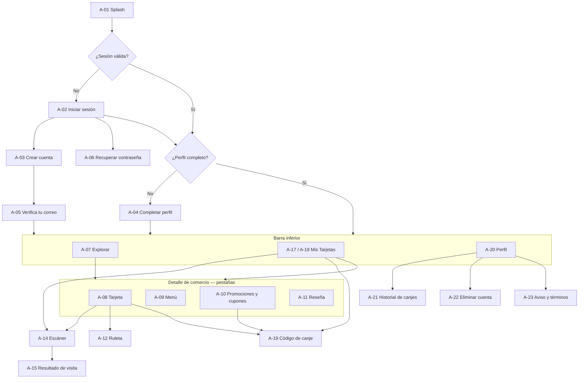

### 1.2 Panel del comercio

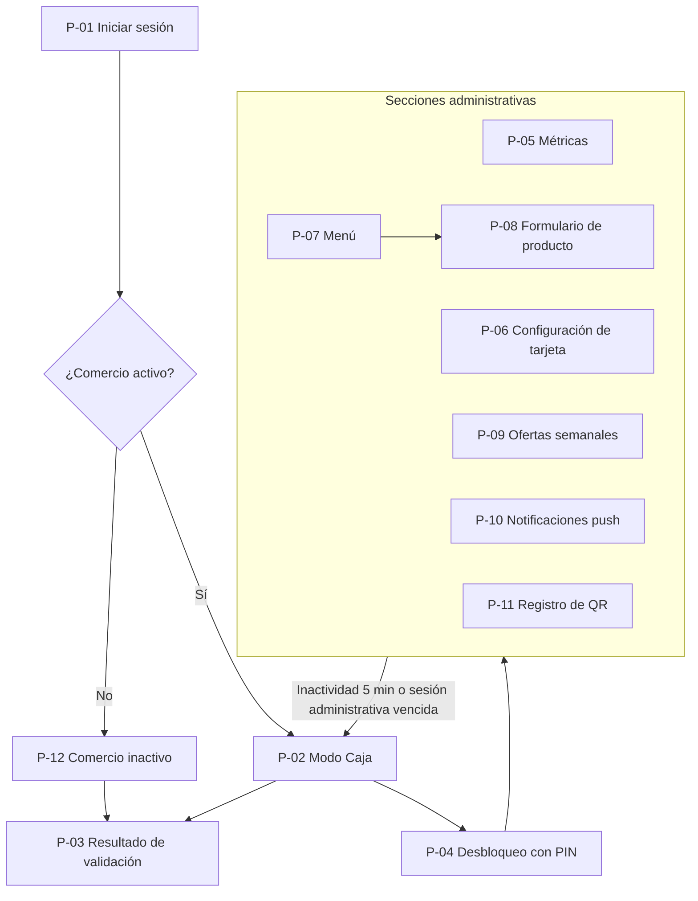

---

## 2. Puntos de entrada y salida

### 2.1 Entradas

| ID | Entrada | Destino | Flujo |
|---|---|---|---|
| EN-01 | Abrir la app desde el ícono | A-01 Splash | F-01 |
| EN-02 | QR escaneado con la cámara nativa (`/v/:token`), app instalada | Procesamiento de visita | F-09 |
| EN-03 | QR escaneado con la cámara nativa, app no instalada | W-01 Página de descarga | F-09 |
| EN-04 | Toque en notificación push | A-10 Promociones y cupones del comercio emisor | F-13 |
| EN-05 | Enlace de verificación de correo | Confirmación y regreso a la app | F-04 |
| EN-06 | Enlace de recuperación de contraseña | Pantalla para nueva contraseña | F-05 |
| EN-07 | Abrir `ekko.oxis.mx` | P-01 o P-02 según sesión | F-20 |

### 2.2 Salidas

| ID | Salida | Origen | Comportamiento |
|---|---|---|---|
| SA-01 | Google Maps (ubicación) | Tarjeta del catálogo, encabezado del comercio | Abre la app de Maps o el navegador; al volver, la app conserva el estado. |
| SA-02 | Google Maps (reseñas) | A-11 | Igual que SA-01. |
| SA-03 | Aviso de privacidad y términos | A-03, A-04, A-23 | Vista web externa. |
| SA-04 | Ajustes del sistema | Permiso denegado de cámara o notificaciones | Abre los ajustes de la app. |
| SA-05 | Cerrar sesión | A-20 | Regresa a A-02; elimina el token push de ese dispositivo. |
| SA-06 | Eliminar cuenta | A-22 | Regresa a A-02 sin sesión. |
| SA-07 | App Store / Google Play | W-01 | Descarga de la app. |

---

## 3. Flujos de autenticación (cliente)

### F-01 Arranque y sesión

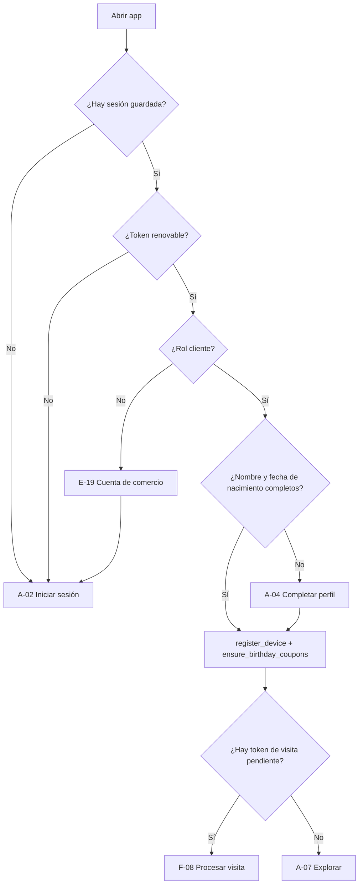

- `register_device` actualiza el hash del dispositivo y, si hay permiso, el Expo Push Token.
- `ensure_birthday_coupons` es idempotente y no bloquea la navegación; si falla se reintenta en la siguiente apertura.

### F-02 Registro con correo (US-01)

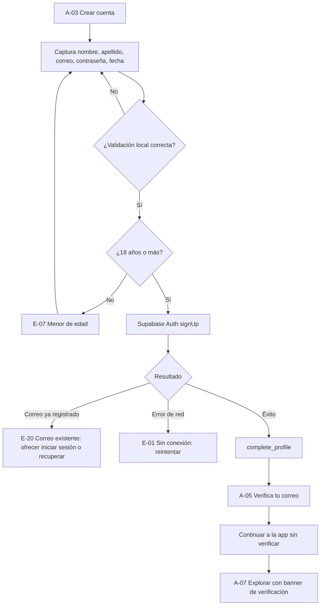

Validaciones locales: nombre y apellido de 2 a 50 caracteres, correo con formato válido, contraseña de 8 caracteres como mínimo, fecha de nacimiento obligatoria, aceptación del aviso de privacidad.

### F-03 Login social (US-02)

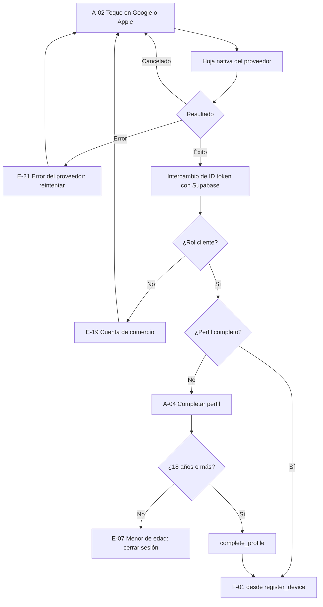

Las cuentas de Google y Apple se consideran verificadas: no muestran A-05 ni el banner.

### F-04 Verificación de correo (RN-05)

| Paso | Acción | Resultado |
|---|---|---|
| 1 | El usuario abre el enlace del correo. | La Edge Function `email-verification` marca el correo como verificado (Backend 6.3; sujeto a SP-7). |
| 2 | El enlace abre la app (o una página de confirmación si se abre en otro dispositivo). | La app refresca la sesión. |
| 3 | La app oculta el banner de verificación. | Se habilitan ruleta y canjes. |

Recuperación:
- "Reenviar correo" desde el banner o A-05, con espera de 60 s entre envíos.
- Enlace vencido: mensaje "Este enlace venció" y botón para reenviar.

Acciones bloqueadas sin verificación: girar la ruleta (A-12 en estado bloqueado) y "Mostrar código" (A-19 en estado bloqueado). Ambas muestran E-06 con el botón de reenvío.

### F-05 Recuperar contraseña (US-03)

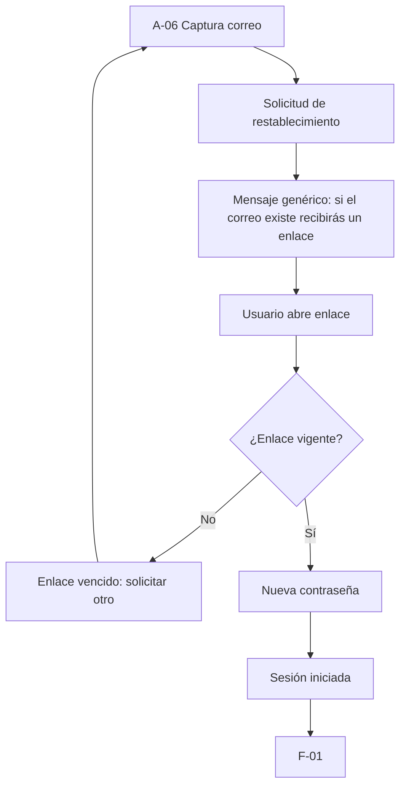

El mensaje del paso C es el mismo exista o no el correo, para no revelar cuentas registradas.

---

## 4. Flujos principales (cliente)

### F-06 Explorar y abrir un comercio (US-07, US-08)

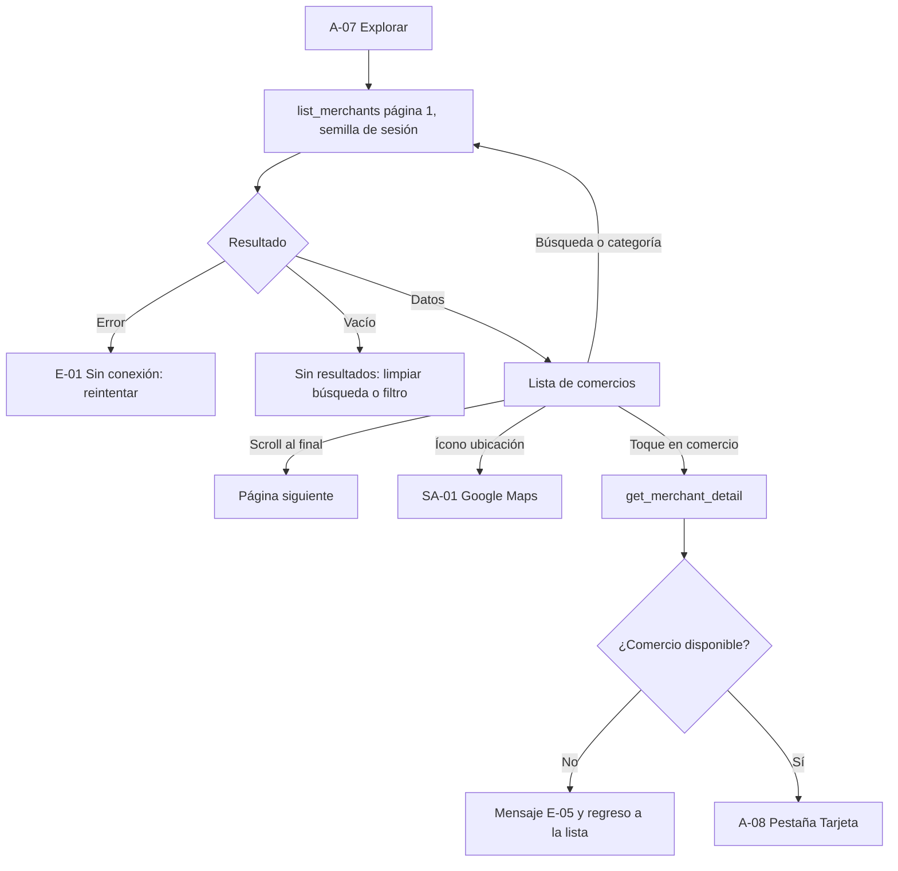

- La búsqueda se ejecuta 300 ms después de la última tecla.
- La semilla de orden aleatorio se conserva hasta que la app se cierra.

### F-07 Agregar tarjeta y ruleta de bienvenida (US-10, US-15)

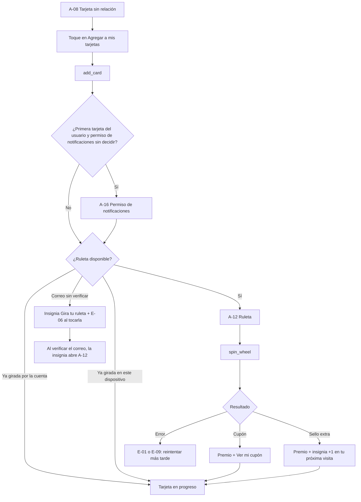

Regla de disponibilidad: la ruleta permanece ofrecida en la tarjeta (insignia "Gira tu ruleta") hasta que la cuenta la gire, siempre que el dispositivo no la haya girado con otra cuenta (RN-07, RN-31).

### F-08 Registrar visita (US-11, US-13)

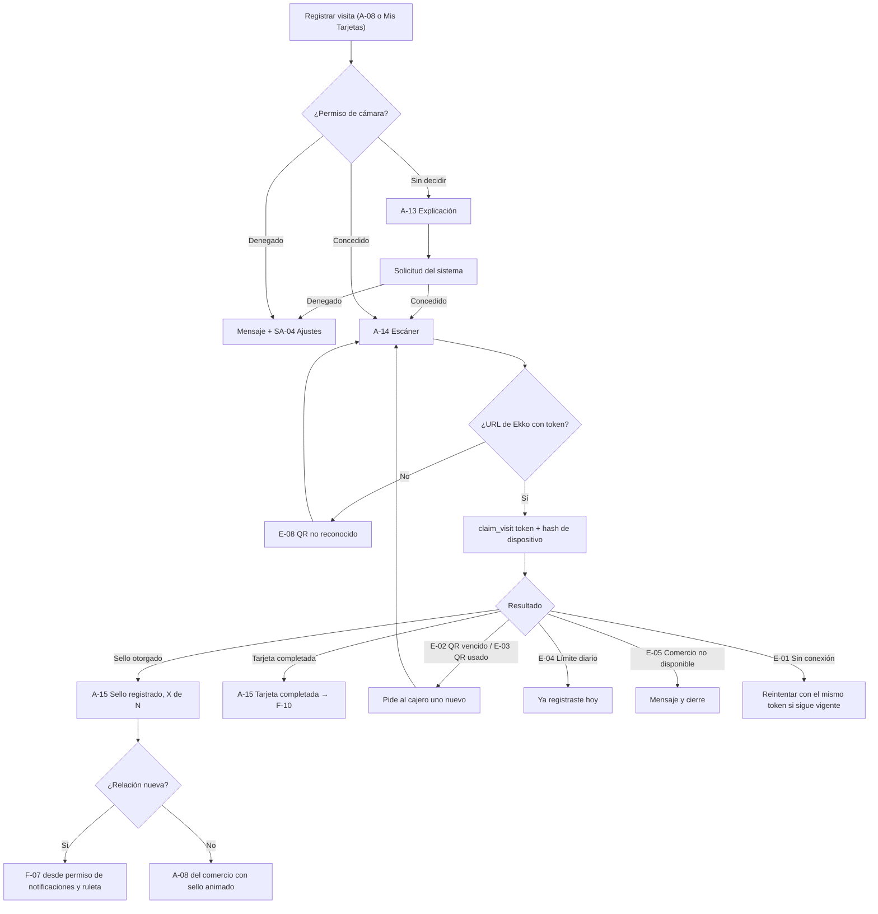

- La cámara se cierra al leer el primer código válido para evitar lecturas dobles.
- Si se aplicó un sello extra pendiente, A-15 indica "+2 sellos".
- El reintento por falta de conexión solo se ofrece mientras el token no haya vencido (la app conoce `expires_at` del token solo tras la respuesta; si no la conoce, reintenta una vez y después muestra E-02).

### F-09 Entrada por enlace universal `/v/:token` (EN-02, EN-03)

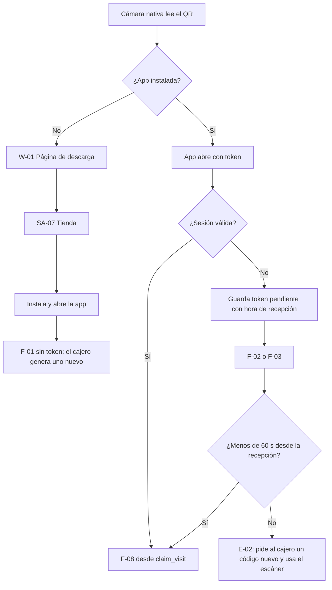

Un usuario nuevo normalmente no completa su registro en 60 s; el flujo esperado en caja es: registrarse, y el cajero genera un nuevo QR. El texto de W-01 y de E-02 lo indica.

### F-10 Tarjeta completada y recompensa (RN-26 a RN-28)

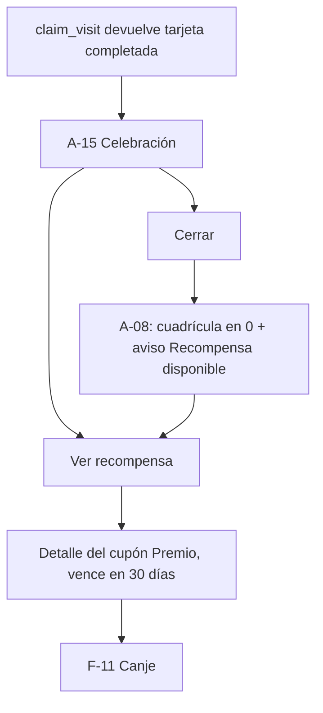

- El aviso "Recompensa disponible" permanece mientras el cupón de premio esté vigente y sin usar.
- Si el cupón vence, el aviso desaparece y el cupón pasa a "Vencido" (visible en el historial).

### F-11 Canje de cupón o premio (US-17)

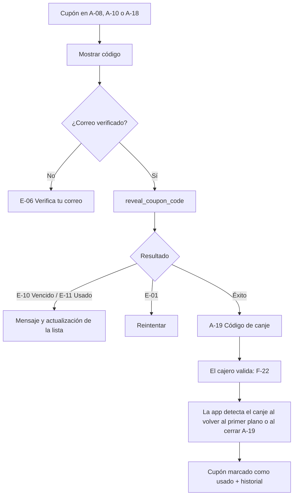

La app no requiere confirmación en tiempo real del canje: al refrescar la lista, el cupón aparece como usado.

### F-12 Cupón de cumpleaños (RN-43 a RN-45)

| Paso | Condición | Resultado |
|---|---|---|
| 1 | La app se abre (F-01). | Se llama `ensure_birthday_coupons`. |
| 2 | El mes actual coincide con el de nacimiento. | Se crea un cupón por cada comercio con relación activa y beneficio configurado que aún no lo tenga este año. |
| 3 | Se crearon cupones nuevos. | Se muestra una sola tarjeta de felicitación en Explorar con acceso a A-18. |
| 4 | No hay cupones nuevos. | Sin cambios visibles. |

### F-13 Notificación push recibida (EN-04)

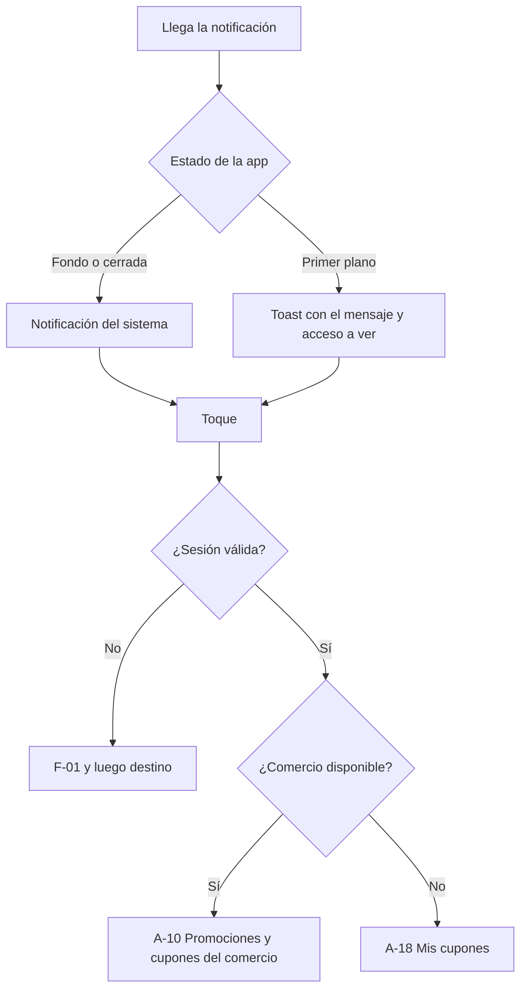

La carga útil de la notificación incluye `merchant_id` y, si aplica, `coupon_id` para resaltar el cupón al abrir A-10.

### F-14 Permisos

| Permiso | Momento | Si se concede | Si se deniega |
|---|---|---|---|
| Cámara | Primer toque en "Registrar visita" (A-13 antes de la solicitud del sistema). | Abre A-14. | Mensaje con SA-04; el botón vuelve a ofrecer los ajustes. |
| Notificaciones | Tras agregar la primera tarjeta o recibir el primer sello (A-16 antes de la solicitud). | Se registra el Expo Push Token. | Se continúa sin push; los cupones de push igualmente aparecen en la app (RN-48). Se puede activar desde Perfil. |

### F-15 Eliminar cuenta (US-05)

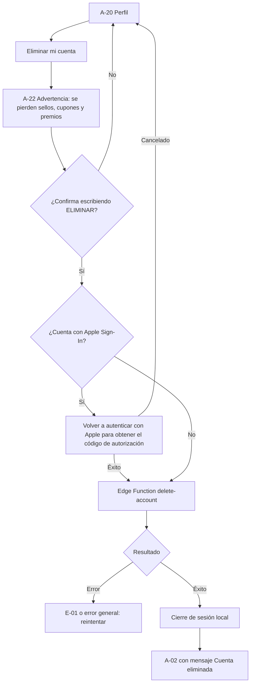

### F-16 Cerrar sesión

Perfil → "Cerrar sesión" → confirmación → desactivar el token push del dispositivo → borrar sesión segura y caché en memoria → A-02.

---

## 5. Flujos del panel del comercio

### F-20 Inicio de sesión del comercio

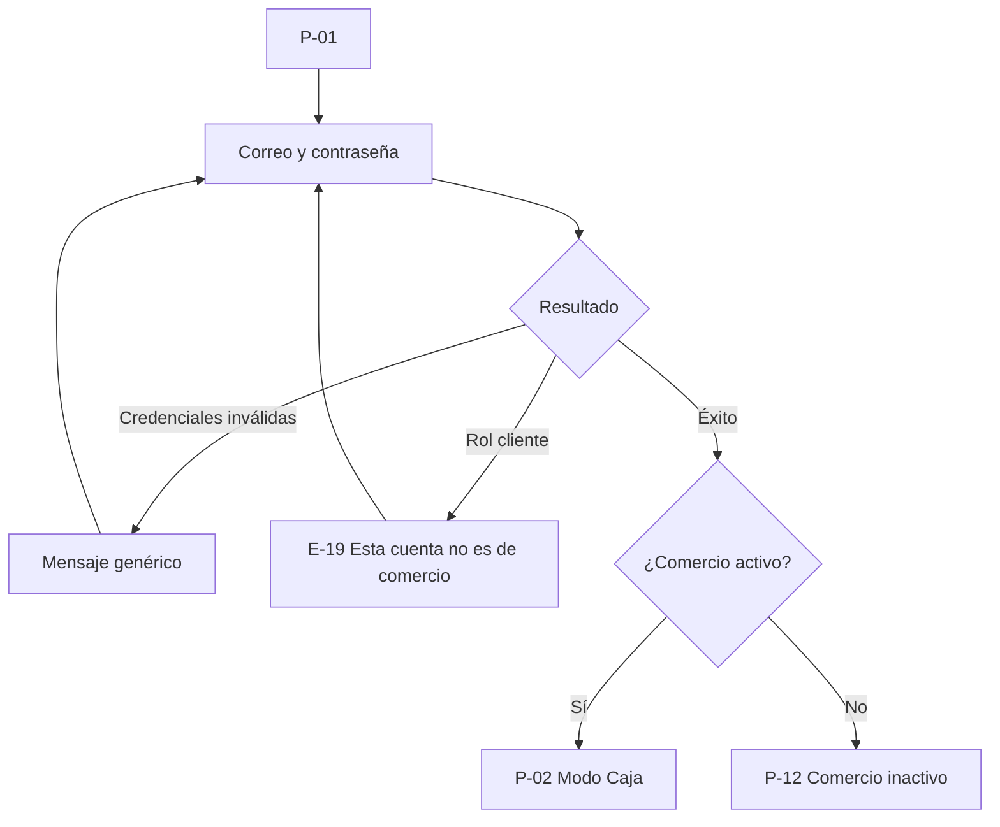

La sesión se mantiene en el dispositivo de caja (renovación automática). La contraseña olvidada se resuelve con Oxis.

### F-21 Generar QR de visita (US-19)

```mermaid
flowchart TD
  A[P-02 Listo] --> B[Generar QR]
  B --> C[generate_visit_qr]
  C --> D{Resultado}
  D -- Error --> E[Mensaje + reintentar]
  D -- Éxito --> F[QR + cuenta regresiva 60 s + suscripción Realtime]
  F --> G{Evento}
  G -- "Token usado" --> H[Visita registrada en verde, 3 s] --> A
  G -- "Llega a 0 s" --> I[QR vencido] --> A
  G -- "Generar otro" --> C
  G -- "Pérdida de conexión Realtime" --> J[Consulta de estado cada 3 s hasta reconectar]
  J --> G
```

Generar un QR nuevo invalida el pendiente anterior del mismo comercio (TRD 6.4).

### F-22 Validar canje (US-20)

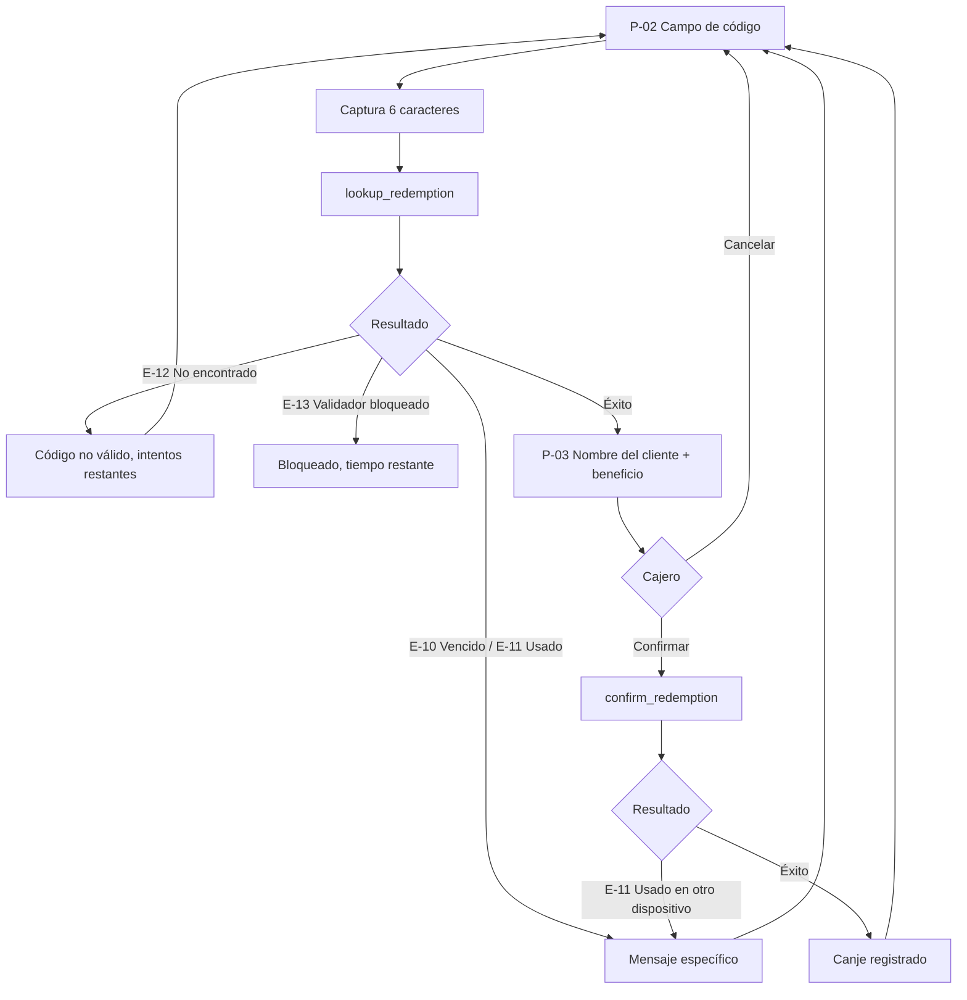

El código de otro comercio se trata como "no encontrado" para no revelar información.

### F-23 Desbloqueo administrativo y expiración (US-21)

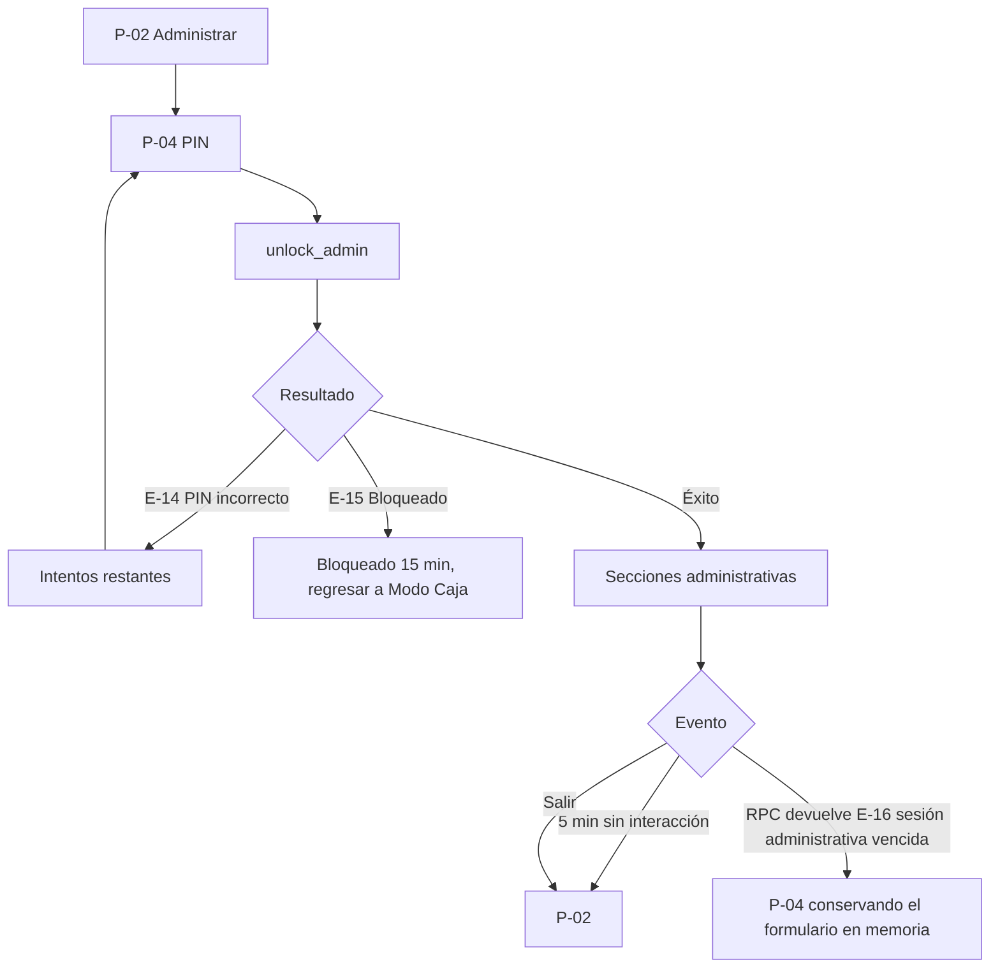

Si la sesión administrativa vence durante una edición, el formulario no se pierde: tras el PIN, el usuario reintenta guardar.

### F-24 Configuración de tarjeta (US-22)

P-06 → editar campos → "Guardar" → modal "Los cambios aplicarán a las tarjetas nuevas" → confirmar → `update_card_config` → éxito o error de validación por campo (sellos fuera de 4 a 10, vigencia fuera de 3 a 12 meses, vigencia de push fuera de 24 a 48 h).

Imagen de fondo: selección → recorte a 1.586:1 → generación de variantes WebP (respaldo JPEG) → subida → vista previa de la tarjeta con sellos de ejemplo → guardar.

### F-25 Gestión del menú (US-23)

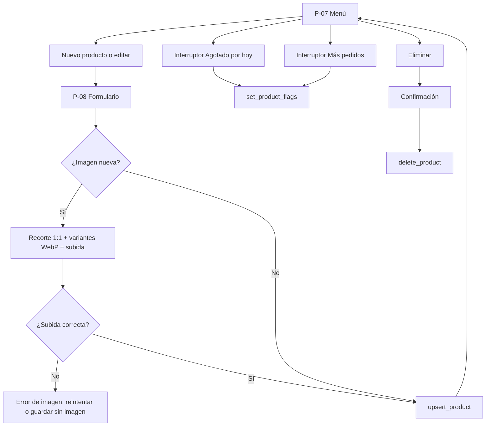

### F-26 Ofertas semanales (US-24)

P-09 → nueva o editar → título, descripción, día de la semana, imagen 16:9 → `upsert_offer` → lista. Eliminar requiere confirmación.

### F-27 Enviar notificación push (US-25)

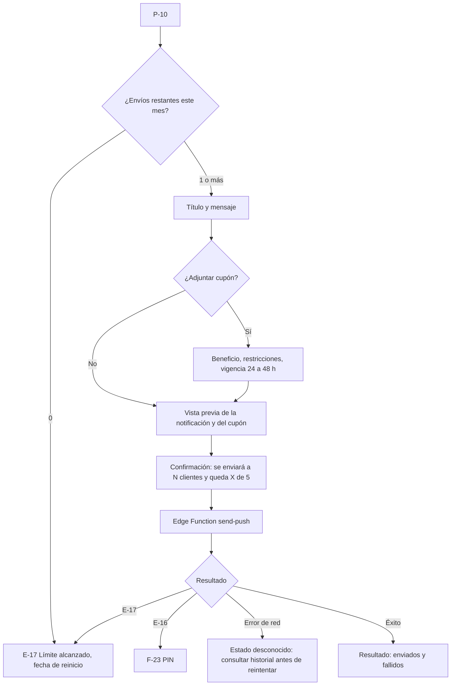

Para evitar envíos duplicados, el botón se deshabilita al enviar, y la campaña lleva una clave de idempotencia generada en el panel.

### F-28 Comercio inactivo (RN-71)

| Pantalla | Comportamiento |
|---|---|
| P-12 | Aviso "Tu suscripción no está activa. Contacta a Oxis para reactivarla." |
| Validador | Disponible: permite canjear beneficios ya emitidos (F-22). |
| Generar QR, PIN y secciones administrativas | Ocultos. |
| Reactivación | Al detectar el cambio de estado (al recargar o iniciar sesión), el panel vuelve a P-02. |

---

## 6. Flujos de operación Oxis

| Flujo | Disparador | Pasos | Resultado |
|---|---|---|---|
| F-30 Alta de comercio | Contrato firmado y pago del onboarding | 1. Reunir datos e imágenes. 2. Ejecutar `onboard-merchant.ts` en staging y revisar en la app de staging. 3. Ejecutar en producción. 4. Entregar credenciales y PIN. 5. Capacitar. 6. Marcar `is_visible = true`. | Comercio visible y operando. |
| F-31 Vencimiento | Fin del periodo pagado | 1. Script lista comercios por vencer y vencidos. 2. Contacto de cobranza. 3. Tras 15 días de gracia sin pago, `set-merchant-status.ts` a inactivo. | RN-70, RN-71. |
| F-32 Reactivación | Pago recibido | `set-merchant-status.ts` a activo con nueva fecha de vencimiento. | Datos y progreso intactos (RN-72). |
| F-33 Restablecer PIN | Solicitud del comercio | Verificar identidad del dueño por el canal acordado → `reset-pin.ts` → comunicar el PIN nuevo. | RN-65. |
| F-34 Restablecer contraseña del comercio | Solicitud del comercio | Verificar identidad → restablecer desde Supabase Studio o script. | — |
| F-35 Corrección de fecha de nacimiento | Solicitud del cliente al soporte | Verificar titularidad del correo → corrección por script. | RN-04. |

---

## 7. Catálogo de errores y recuperación

Las RPC devuelven un código estable; la interfaz traduce cada código a un mensaje y una acción.

| Código | Situación | Dónde ocurre | Mensaje (resumen) | Acción de recuperación |
|---|---|---|---|---|
| E-01 | Sin conexión o tiempo agotado | Global | No hay conexión. | Reintentar. |
| E-02 | QR vencido | F-08, F-09 | Este código ya no es válido. | Pedir uno nuevo al cajero; volver al escáner. |
| E-03 | QR ya usado | F-08 | Este código ya fue usado. | Igual que E-02. |
| E-04 | Límite diario de sellos | F-08 | Ya registraste tu visita de hoy. | Cerrar. |
| E-05 | Comercio no disponible | F-06, F-08, F-13 | Este negocio no está disponible por ahora. | Volver; los sellos se conservan. |
| E-06 | Correo sin verificar | F-07, F-11 | Verifica tu correo para continuar. | Reenviar correo. |
| E-07 | Menor de edad | F-02, F-03 | Solo para mayores de 18 años. | Corregir fecha o salir. |
| E-08 | QR no reconocido | F-08 | Este no es un código de Ekko. | Seguir escaneando. |
| E-09 | Ruleta ya girada (cuenta o dispositivo) | F-07 | Ya usaste tu giro de bienvenida en este negocio. | Cerrar. |
| E-10 | Cupón vencido | F-11, F-22 | Este cupón venció. | Actualizar lista. |
| E-11 | Cupón ya usado | F-11, F-22 | Este cupón ya fue canjeado. | Actualizar lista. |
| E-12 | Código no encontrado | F-22 | Código no válido. | Revisar y volver a capturar. |
| E-13 | Validador bloqueado | F-22 | Demasiados intentos. Espera unos minutos. | Esperar el tiempo indicado. |
| E-14 | PIN incorrecto | F-23 | PIN incorrecto. Te quedan N intentos. | Reintentar. |
| E-15 | PIN bloqueado | F-23 | Acceso bloqueado por 15 minutos. | Esperar o contactar a Oxis. |
| E-16 | Sesión administrativa vencida | F-23, F-24 a F-27 | Ingresa tu PIN para continuar. | P-04 conservando el formulario. |
| E-17 | Límite de push alcanzado | F-27 | Usaste tus 5 envíos de este mes. | Esperar al siguiente mes. |
| E-18 | Sesión expirada | Global | Tu sesión expiró. | Iniciar sesión; regresar al destino previo. |
| E-19 | Rol incorrecto | F-01, F-03, F-20 | Esta cuenta no corresponde a esta aplicación. | Cerrar sesión. |
| E-20 | Correo ya registrado | F-02 | Ya existe una cuenta con este correo. | Iniciar sesión o recuperar contraseña. |
| E-21 | Error del proveedor social | F-03 | No pudimos conectar con Google/Apple. | Reintentar u otro método. |
| E-22 | Error de imagen | F-24 a F-26 | No pudimos procesar la imagen. | Otra imagen o reintentar. |
| E-99 | Error inesperado | Global | Algo salió mal. | Reintentar; el error se reporta a Sentry. |

### 7.1 Reglas generales de recuperación

| Regla | Descripción |
|---|---|
| RR-1 | Toda acción que modifica datos deshabilita su botón mientras espera respuesta. |
| RR-2 | Las operaciones del servidor son idempotentes ante reintentos: un reintento de `claim_visit` con el mismo token no otorga dos sellos; un reintento de `confirm_redemption` no duplica el canje. |
| RR-3 | Ante E-18, la app conserva el destino y el token de visita pendiente para retomarlos tras el login. |
| RR-4 | Las listas se refrescan al volver la app a primer plano y con gesto de arrastrar. |
| RR-5 | Ningún error deja al usuario sin una acción visible para continuar. |
