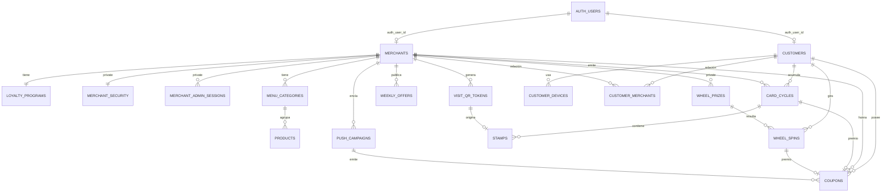

# Esquema del Backend — Ekko Rewards

| Campo | Valor |
|---|---|
| Producto | Ekko Rewards |
| Documento | Esquema del Backend |
| Versión | 1.1 (resultados de Sprint 0: verificación de correo por ADR-14) |
| Fecha | 20 de octubre de 2026 |
| Estado | Borrador para aprobación |
| Documentos base | ekko_prd.md, ekko_trd.md, ekko_appflow.md (v1.0) |
| Plataforma | Supabase (Postgres, Auth, Storage, Realtime, Edge Functions) |

Convenciones: reglas RN-xx (PRD), errores E-xx (AppFlow, sección 7), spikes SP-xx (TRD, sección 14).

---

## 1. Organización de la base de datos

| Esquema | Expuesto por la API | Contenido |
|---|---|---|
| `public` | Sí | Tablas legibles con RLS y funciones RPC invocables por clientes y comercios. |
| `private` | No | Datos sensibles: seguridad del comercio, sesiones administrativas, pesos de la ruleta, vistas de KPIs. |
| `app` | No | Funciones auxiliares internas (identidad, fechas, hashing, errores). |
| `auth`, `storage` | Gestionados por Supabase | Usuarios y archivos. |

Reglas generales:
- Todas las tablas de `public` tienen RLS habilitado. Las tablas transaccionales no tienen políticas de `INSERT`, `UPDATE` ni `DELETE`: solo se modifican mediante RPC `SECURITY DEFINER`.
- Todas las RPC fijan `search_path = ''` y usan nombres calificados.
- Claves primarias `uuid` generadas con `gen_random_uuid()`.
- Fechas en `timestamptz` (UTC). Los cálculos de día y mes usan `app.local_now()` = `app.now() AT TIME ZONE 'America/Mexico_City'` (ADR-13: ninguna función llama a `now()` directamente).
- `created_at` y `updated_at` en todas las tablas editables; `updated_at` mantenido por trigger.

---

## 2. Modelo de datos

### 2.1 Diagrama entidad-relación



### 2.2 Tipos enumerados

| Tipo | Valores |
|---|---|
| `merchant_category` | `restaurantes`, `cafeterias_postres`, `bares_snacks`, `barberias`, `belleza`, `spas`, `deporte_salud`, `servicios`, `otros` |
| `subscription_status` | `active`, `past_due`, `inactive` |
| `billing_period` | `quarterly`, `annual` |
| `customer_status` | `active`, `deleted` |
| `relation_origin` | `add_card`, `first_stamp` |
| `cycle_status` | `active`, `completed`, `expired` |
| `wheel_prize_type` | `coupon`, `extra_stamp` |
| `coupon_source` | `card_reward`, `wheel`, `push`, `birthday` |
| `coupon_status` | `active`, `redeemed` (el vencimiento se deriva de `expires_at`) |
| `campaign_status` | `pending`, `sending`, `sent`, `failed` |
| `device_platform` | `ios`, `android` |

### 2.3 Tablas del esquema `public`

#### `customers`
| Columna | Tipo | Restricciones | Notas |
|---|---|---|---|
| `id` | uuid | PK | Identificador estable; sobrevive a la eliminación del usuario de Auth. |
| `auth_user_id` | uuid | UNIQUE, FK `auth.users(id)` ON DELETE SET NULL, nullable | Nulo tras eliminar la cuenta. |
| `first_name` | text | nullable, 2–50 caracteres | Nulo hasta completar el perfil y tras anonimizar. |
| `last_name` | text | nullable, 2–50 caracteres | — |
| `birth_date` | date | nullable | Solo se fija una vez (RN-04). |
| `email_verified_at` | timestamptz | nullable | Se fija por trigger al verificar el OTP (ver 6.3). |
| `auth_provider` | text | NOT NULL | `email`, `google` o `apple`. |
| `status` | customer_status | NOT NULL, default `active` | — |
| `deleted_at` | timestamptz | nullable | — |
| `created_at`, `updated_at` | timestamptz | NOT NULL | — |

La mayoría de edad (18+) se valida en `complete_profile` con `app.now()`, no con un `CHECK`: un `CHECK` con `current_date` ignora el reloj controlable (ADR-13) e impide probar TC-002 y TC-003.

#### `merchants`
| Columna | Tipo | Restricciones | Notas |
|---|---|---|---|
| `id` | uuid | PK | — |
| `auth_user_id` | uuid | UNIQUE, FK `auth.users(id)` | Credencial única (RN-61). |
| `name` | text | NOT NULL, ≤ 40 caracteres | Incluye sucursal si aplica. |
| `category` | merchant_category | NOT NULL | Una sola (RN-51). |
| `description` | text | NOT NULL, ≤ 140 caracteres | — |
| `address` | text | NOT NULL | Distingue sucursales. |
| `logo_path` | text | NOT NULL | Ruta base en Storage (sin sufijo de ancho). |
| `cover_path` | text | NOT NULL | — |
| `maps_url` | text | NOT NULL | RN-59. |
| `reviews_url` | text | NOT NULL | RN-59. |
| `birthday_benefit` | text | nullable | Nulo = sin cupón de cumpleaños (RN-44). |
| `push_coupon_validity_hours` | smallint | NOT NULL, default 48, CHECK 24–48 | — |
| `is_active` | boolean | NOT NULL, default false | Operación permitida. |
| `is_visible` | boolean | NOT NULL, default false | Visible en catálogo (RN-53). |
| `subscription_status` | subscription_status | NOT NULL | — |
| `billing_period` | billing_period | NOT NULL | — |
| `paid_until` | date | NOT NULL | Base del periodo de gracia (RN-70). |
| `created_at`, `updated_at` | timestamptz | NOT NULL | — |

#### `loyalty_programs`
| Columna | Tipo | Restricciones | Notas |
|---|---|---|---|
| `merchant_id` | uuid | PK, FK `merchants` | Un programa por comercio (RN-22). |
| `stamps_required` | smallint | NOT NULL, default 6, CHECK 4–10 | RN-23. |
| `cycle_months` | smallint | NOT NULL, default 6, CHECK 3–12 | RN-24. |
| `reward_title` | text | NOT NULL, ≤ 60 | — |
| `reward_description` | text | NOT NULL, ≤ 200 | — |
| `terms` | text | NOT NULL, ≤ 1,000 | Incluye consumo mínimo (RN-18). |
| `card_background_path` | text | nullable | Nulo = plantilla estándar. |
| `updated_at` | timestamptz | NOT NULL | — |

#### `customer_merchants` (relación)
| Columna | Tipo | Restricciones | Notas |
|---|---|---|---|
| `customer_id` | uuid | PK compuesta, FK `customers` | — |
| `merchant_id` | uuid | PK compuesta, FK `merchants` | — |
| `origin` | relation_origin | NOT NULL | RN-10. |
| `pending_extra_stamps` | smallint | NOT NULL, default 0, CHECK ≥ 0 | RN-36. |
| `created_at` | timestamptz | NOT NULL | — |

#### `card_cycles`
| Columna | Tipo | Restricciones | Notas |
|---|---|---|---|
| `id` | uuid | PK | — |
| `customer_id` | uuid | FK `customers` | — |
| `merchant_id` | uuid | FK `merchants` | — |
| `status` | cycle_status | NOT NULL | — |
| `stamps_required` | smallint | NOT NULL | Copia al iniciar (RN-29). |
| `stamps_count` | smallint | NOT NULL, default 0 | Desnormalizado para lectura rápida. |
| `reward_title`, `reward_description`, `terms` | text | NOT NULL | Copia al iniciar (RN-29). |
| `started_at` | timestamptz | NOT NULL | — |
| `expires_at` | timestamptz | NOT NULL | `started_at + cycle_months` (RN-24). |
| `closed_at` | timestamptz | nullable | Al completarse o vencer. |

Índice único parcial: `(customer_id, merchant_id) WHERE status = 'active'` — un ciclo activo por relación.

#### `stamps`
| Columna | Tipo | Restricciones | Notas |
|---|---|---|---|
| `id` | uuid | PK | — |
| `cycle_id` | uuid | FK `card_cycles` | — |
| `customer_id` | uuid | FK `customers` | — |
| `merchant_id` | uuid | FK `merchants` | — |
| `qr_token_id` | uuid | FK `visit_qr_tokens`, nullable | Nulo en sellos extra. |
| `is_bonus` | boolean | NOT NULL, default false | Sello extra de ruleta. |
| `local_date` | date | NOT NULL | Fecha en `America/Mexico_City`. |
| `granted_at` | timestamptz | NOT NULL | RN-19. |

Índice único parcial: `(customer_id, merchant_id, local_date) WHERE is_bonus = false` — límite de 1 sello por día (RN-17).

#### `visit_qr_tokens`
| Columna | Tipo | Restricciones | Notas |
|---|---|---|---|
| `id` | uuid | PK | Se usa para la suscripción Realtime del panel. |
| `merchant_id` | uuid | FK `merchants` | — |
| `token_hash` | bytea | UNIQUE, NOT NULL | SHA-256 del token; el token en claro nunca se guarda. |
| `created_at` | timestamptz | NOT NULL | — |
| `expires_at` | timestamptz | NOT NULL | `created_at + 60 s` (RN-14). |
| `used_at` | timestamptz | nullable | — |
| `used_by_customer_id` | uuid | FK `customers`, nullable | No se expone al comercio. |
| `invalidated_at` | timestamptz | nullable | Al generar un QR nuevo. |

#### `wheel_spins`
| Columna | Tipo | Restricciones | Notas |
|---|---|---|---|
| `id` | uuid | PK | — |
| `customer_id` | uuid | FK `customers` | — |
| `merchant_id` | uuid | FK `merchants` | — |
| `prize_id` | uuid | FK `private.wheel_prizes` | — |
| `device_hash` | bytea | NOT NULL | Con pimienta del servidor. |
| `email_hash` | bytea | NOT NULL | Con pimienta del servidor (RN-09). |
| `spun_at` | timestamptz | NOT NULL | — |

Índices únicos: `(customer_id, merchant_id)`, `(device_hash, merchant_id)`, `(email_hash, merchant_id)`.

#### `coupons`
| Columna | Tipo | Restricciones | Notas |
|---|---|---|---|
| `id` | uuid | PK | — |
| `customer_id` | uuid | FK `customers` | — |
| `merchant_id` | uuid | FK `merchants` | — |
| `source` | coupon_source | NOT NULL | — |
| `cycle_id` | uuid | FK `card_cycles`, nullable, UNIQUE | Origen `card_reward`. |
| `spin_id` | uuid | FK `wheel_spins`, nullable, UNIQUE | Origen `wheel`. |
| `campaign_id` | uuid | FK `push_campaigns`, nullable | Origen `push`. |
| `birthday_year` | smallint | nullable | Origen `birthday`. |
| `title` | text | NOT NULL | — |
| `description` | text | NOT NULL | — |
| `terms` | text | nullable | — |
| `code` | char(6) | NOT NULL | Alfabeto del TRD 6.5. |
| `status` | coupon_status | NOT NULL, default `active` | — |
| `issued_at` | timestamptz | NOT NULL | — |
| `expires_at` | timestamptz | NOT NULL | Según tabla de vigencias (PRD 6.6). |
| `redeemed_at` | timestamptz | nullable | — |
| `redeemed_by_session_id` | uuid | nullable | `session_id` del JWT del comercio que canjeó (S14); acota el reintento idempotente de `confirm_redemption`. |

Índices únicos:
- `(merchant_id, code)` — un código no se repite dentro del comercio en toda su historia (31^6 ≈ 887 millones de combinaciones; ante colisión se regenera).
- `(campaign_id, customer_id) WHERE source = 'push'`.
- `(customer_id, merchant_id, birthday_year) WHERE source = 'birthday'`.

Restricción: `CHECK` que exige la columna de origen correspondiente a `source`.

#### `customer_devices`
| Columna | Tipo | Restricciones | Notas |
|---|---|---|---|
| `id` | uuid | PK | — |
| `customer_id` | uuid | FK `customers` | — |
| `device_hash` | bytea | NOT NULL | Con pimienta del servidor. |
| `platform` | device_platform | NOT NULL | — |
| `expo_push_token` | text | nullable | — |
| `push_enabled` | boolean | NOT NULL, default false | — |
| `last_seen_at` | timestamptz | NOT NULL | — |
| `signed_out_at` | timestamptz | nullable | Al cerrar sesión, se borra el token. |

Índice único: `(customer_id, device_hash)`.

#### `menu_categories`
| Columna | Tipo | Restricciones |
|---|---|---|
| `id` | uuid | PK |
| `merchant_id` | uuid | FK `merchants` |
| `name` | text | NOT NULL, ≤ 30 |
| `position` | smallint | NOT NULL |

#### `products`
| Columna | Tipo | Restricciones | Notas |
|---|---|---|---|
| `id` | uuid | PK | — |
| `merchant_id` | uuid | FK `merchants` | — |
| `category_id` | uuid | FK `menu_categories` ON DELETE RESTRICT | — |
| `name` | text | NOT NULL, ≤ 60 | — |
| `description` | text | ≤ 200 | — |
| `price` | numeric(10,2) | NOT NULL, CHECK ≥ 0 | MXN. |
| `image_path` | text | nullable | — |
| `is_featured` | boolean | NOT NULL, default false | "Más pedidos" (RN-57). |
| `sold_out_on` | date | nullable | Agotado si es igual a la fecha local (RN-56). |
| `position` | smallint | NOT NULL | — |
| `created_at`, `updated_at` | timestamptz | NOT NULL | — |

#### `weekly_offers`
| Columna | Tipo | Restricciones |
|---|---|---|
| `id` | uuid | PK |
| `merchant_id` | uuid | FK `merchants` |
| `title` | text | NOT NULL, ≤ 60 |
| `description` | text | NOT NULL, ≤ 200 |
| `weekday` | smallint | NOT NULL, CHECK 1–7 (ISO: 1 = lunes) |
| `image_path` | text | nullable |
| `position` | smallint | NOT NULL |

#### `push_campaigns`
| Columna | Tipo | Restricciones | Notas |
|---|---|---|---|
| `id` | uuid | PK | — |
| `merchant_id` | uuid | FK `merchants` | — |
| `idempotency_key` | uuid | NOT NULL | Generada por el panel. |
| `title` | text | NOT NULL, ≤ 50 | — |
| `body` | text | NOT NULL, ≤ 150 | — |
| `has_coupon` | boolean | NOT NULL | — |
| `coupon_title`, `coupon_description`, `coupon_terms` | text | nullable | Obligatorios si `has_coupon`. |
| `coupon_validity_hours` | smallint | nullable, CHECK 24–48 | — |
| `local_month` | date | NOT NULL | Primer día del mes local (cuota RN-47). |
| `status` | campaign_status | NOT NULL | — |
| `recipients_count`, `sent_count`, `failed_count` | integer | NOT NULL, default 0 | — |
| `created_at` | timestamptz | NOT NULL | — |

Índice único: `(merchant_id, idempotency_key)`.

### 2.4 Tablas del esquema `private`

| Tabla | Columnas principales | Propósito |
|---|---|---|
| `merchant_security` | `merchant_id` PK, `pin_hash` (bcrypt), `pin_failed_count`, `pin_locked_until`, `code_failed_count`, `code_window_started_at`, `validator_locked_until` | PIN (RN-63) y antiadivinación del validador (TRD 6.5). |
| `merchant_admin_sessions` | `id`, `merchant_id`, `auth_session_id` (claim `session_id` del JWT), `expires_at` | Desbloqueo administrativo por dispositivo con expiración deslizante de 5 min. |
| `wheel_prizes` | `id`, `merchant_id`, `label` (≤ 30), `prize_type`, `benefit_title`, `benefit_description`, `weight` (> 0), `position`, `is_active` | Premios y pesos de la ruleta (RN-33). |

### 2.5 Índices adicionales

| Tabla | Índice | Uso |
|---|---|---|
| `merchants` | `(is_visible, category)` | Catálogo filtrado. |
| `merchants` | `gin (name gin_trgm_ops)` con `pg_trgm` | Búsqueda por nombre. |
| `card_cycles` | `(merchant_id, status)` | Métricas. |
| `stamps` | `(merchant_id, granted_at)` | Métricas y clientes activos. |
| `coupons` | `(customer_id, status, expires_at)` | "Mis cupones". |
| `coupons` | `(merchant_id, redeemed_at)` | Métricas de canjes. |
| `visit_qr_tokens` | `(merchant_id, created_at DESC)` | Registro de QR. |
| `customer_merchants` | `(merchant_id)` | Destinatarios de push. |
| `customer_devices` | `(customer_id) WHERE expo_push_token IS NOT NULL AND signed_out_at IS NULL` | Envío de push. |
| `products` | `(merchant_id, category_id, position)` | Menú. |

---

## 3. Funciones auxiliares (`app`)

| Función | Retorna | Descripción |
|---|---|---|
| `app.now()` | timestamptz | Hora actual; respeta `app.fake_now` en sesiones SQL directas (pruebas). Definida en la migración 002 (ADR-13). |
| `app.local_now()` | timestamp | Hora local de Ciudad de México, derivada de `app.now()`. |
| `app.local_today()` | date | Fecha local. |
| `app.current_customer()` | `customers` | Cliente del JWT con `status = 'active'`; si no existe, lanza E-18 o E-19. |
| `app.current_merchant()` | `merchants` | Comercio del claim `app_metadata.merchant_id`; si no existe, lanza E-19. |
| `app.require_active_merchant()` | `merchants` | Además exige `is_active`; si no, lanza E-05. |
| `app.require_admin_session()` | void | Verifica y extiende 5 min la sesión administrativa del `session_id` actual; si no existe o venció, lanza E-16. |
| `app.is_email_verified(customer)` | boolean | `auth_provider IN ('google','apple') OR email_verified_at IS NOT NULL`. |
| `app.peppered_hash(text)` | bytea | SHA-256 de `valor || pimienta`; la pimienta se lee de Supabase Vault. |
| `app.random_code()` | char(6) | Código con `gen_random_bytes` sobre el alfabeto de 31 símbolos. Solo local/pruebas (RQ-2): si `app.fake_codes` (lista separada por comas) está fijado, devuelve sus entradas en orden (índice en la secuencia `app.fake_code_seq`, que no revierte con subtransacciones) y luego vuelve a ser aleatorio. Como `app.fake_now`, no se puede fijar vía PostgREST. |
| `app.raise(code text, detail jsonb)` | void | Lanza `RAISE EXCEPTION USING ERRCODE = 'P0001', MESSAGE = code, DETAIL = detail::text`. |
| `app.roll_cycle(customer_id, merchant_id)` | `card_cycles` | Bloquea el ciclo activo (`FOR UPDATE`); si venció (`expires_at <= app.now()`) lo cierra como `expired` y abre uno nuevo con la configuración vigente; si no existe, lo crea. Concurrencia: el índice único parcial rechaza el segundo ciclo activo; ante `unique_violation` relee y devuelve el del ganador (verificado con dos sesiones simultáneas). Migración `card_cycle` (S4). |
| `app.wheel_status(customer, merchant)` | text | Estado de la ruleta para un cliente CON relación: `spun` → `unavailable` (comercio inactivo o sin premios activos) → `needs_verification` → `available`. Migración `merchant_detail_rpc` (S4). |
| `app.grant_stamps(cycle, n, qr_token_id, is_bonus)` | jsonb | Inserta sellos, actualiza `stamps_count` y, si se completa, cierra el ciclo, emite el cupón de premio (30 días) y abre un ciclo nuevo (RN-26). S5: el llamador ya bloqueó el ciclo (`roll_cycle`); con `is_bonus = false` el primer sello es el de visita (lleva `qr_token_id`, cuenta para el límite diario) y los demás son extra; topa en `stamps_required` (RN-36); el código del cupón se regenera ante colisión. Retorna `{stamps_added, stamps_count, stamps_required, cycle_completed, reward_coupon_id}` (`stamps_count` del ciclo que recibió los sellos). Migración `claim_visit`. |

### 3.1 Contrato de errores

Las RPC devuelven errores con este formato en la respuesta de PostgREST:

```json
{
  "code": "P0001",
  "message": "E-04",
  "details": "{\"next_available_on\":\"2026-10-21\"}",
  "hint": null
}
```

El cliente lee `message` como código E-xx (AppFlow, sección 7) y `details` como datos opcionales para el texto (intentos restantes, tiempo de bloqueo, fecha de reinicio).

Nota S2: las RPC lanzan **E-23 "Datos inválidos"** cuando un parámetro no cumple el formato, con `details = {"field": "<parámetro sin p_>"}` (p. ej. `first_name`, `last_name`, `birth_date`, `device_id_digest`, `platform`). Pendiente de agregar al catálogo de errores de AppFlow (sección 7).

---

## 4. API — Funciones RPC

Invocación: `POST /rest/v1/rpc/<nombre>` con el JWT del usuario (`supabase.rpc('<nombre>', params)`). Todas son `SECURITY DEFINER`, validan el rol y devuelven `jsonb` salvo que se indique.

### 4.1 Cliente — cuenta y dispositivo

#### `complete_profile`
| Parámetro | Tipo |
|---|---|
| `p_first_name` | text |
| `p_last_name` | text |
| `p_birth_date` | date |

Reglas: recorta espacios de nombre y apellido y exige 2–50 caracteres en cada uno (si no, E-23 con `field` = `first_name` o `last_name`). Si `birth_date` aún es nula: es obligatoria (E-23 `birth_date`) y exige 18+ con `p_birth_date + interval '18 years' <= app.local_today()` (E-07; cumplir 18 hoy se acepta, mañana no; un 29 de febrero cumple el 28). Si ya está fijada, el valor recibido se ignora sin error ni validación (RN-04, TC-007) y nombre y apellido sí se actualizan.
Retorna: `{ "profile_complete": true }`.

#### `get_my_profile`
Retorna:
```json
{
  "first_name": "Daniela",
  "last_name": "Ruiz",
  "birth_date": "2004-03-12",
  "email": "daniela@example.com",
  "auth_provider": "email",
  "email_verified": false,
  "profile_complete": true
}
```
`email` sale de `auth.users`; `email_verified` = `app.is_email_verified`; `profile_complete` = nombre, apellido y `birth_date` no nulos.

#### `register_device`
| Parámetro | Tipo | Notas |
|---|---|---|
| `p_device_id_digest` | text | SHA-256 calculado en la app; el servidor le aplica la pimienta. |
| `p_platform` | device_platform | — |
| `p_expo_push_token` | text, opcional (default `null`) | — |
| `p_push_enabled` | boolean, opcional (default `false`) | — |

Reglas: el digest debe ser 64 caracteres hexadecimales en minúsculas (si no, E-23 `device_id_digest`); `device_hash = app.peppered_hash(digest)`. Upsert por `(customer_id, device_hash)`: actualiza `platform`, `push_enabled`, `last_seen_at = app.now()` y limpia `signed_out_at`; el token solo se sobrescribe si llega uno no nulo.
Retorna: `{ "ok": true }`.

#### `sign_out_device`
| Parámetro | Tipo |
|---|---|
| `p_device_id_digest` | text |

Reglas: mismo digest que `register_device` (E-23 `device_id_digest`); borra `expo_push_token` y fija `signed_out_at = app.now()` de la fila `(customer_id, device_hash)` (F-16). Si la fila no existe, no falla. Un `register_device` posterior la reactiva.
Retorna: `{ "ok": true }`.

#### `ensure_birthday_coupons`
Sin parámetros. Reglas: si el mes local coincide con el de `birth_date`, crea un cupón por cada relación con comercio activo y `birthday_benefit` no nulo, sin duplicar por año (RN-43 a RN-45). Vence el último día del mes a las 23:59:59 locales.
Retorna: `{ "created": 2 }`. Cupón: título `Regalo de cumpleaños`, descripción = `birthday_benefit` (texto); idempotente vía `coupons_birthday_once_idx` + `ON CONFLICT DO NOTHING`; sin `birth_date` → `created: 0`.

#### `list_my_redemptions`
| Parámetro | Tipo |
|---|---|
| `p_offset` | integer, default 0 |
| `p_limit` | integer, default 20 (máx. 50) |

Reglas: cupones `redeemed` del cliente, `redeemed_at` descendente; incluye comercios inactivos. `p_offset < 0` o `p_limit` fuera de 1–50: E-23 (`offset` / `limit`), no se recorta.
Retorna: arreglo de `{ coupon_id, merchant_name, title, source, redeemed_at }` (`[]` si no hay).

### 4.2 Cliente — catálogo y comercio

#### `list_merchants`
| Parámetro | Tipo | Notas |
|---|---|---|
| `p_seed` | text | Semilla de sesión (RN-52). |
| `p_query` | text, opcional | Búsqueda por nombre (trigramas). |
| `p_category` | merchant_category, opcional | — |
| `p_offset` | integer, default 0 | — |
| `p_limit` | integer, default 10 (máx. 20) | — |

Reglas: solo `is_visible = true`; orden `md5(id::text || p_seed)`.

Detalle S3:
- Requiere cliente activo (`app.current_customer()`: E-18 sin sesión, E-19 con JWT de comercio).
- Validación (E-23 con `details.field`): `seed` de 1 a 64 caracteres; `limit` de 1 a 20; `offset` ≥ 0.
- `p_query` se recorta; vacío equivale a sin filtro. Coincidencia por subcadena, sin distinguir mayúsculas ni acentos: `app.search_text(name) LIKE '%' || app.search_text(query) || '%'`, con los comodines de LIKE escapados. `app.search_text` = `lower(unaccent(...))` con diccionario fijo (IMMUTABLE); la extensión `unaccent` se instala en `extensions`.
- Índice: `merchants_name_search_idx` = `gin (app.search_text(name) gin_trgm_ops)` reemplaza al índice de §2.5 sobre `name` (que no serviría para la búsqueda normalizada).
- Empate de `md5` resuelto por `id`. Se leen `limit + 1` filas para calcular `has_more`; una página vacía devuelve `{"items": [], "has_more": false}`.
- La relación cliente-comercio no agrega comercios invisibles al catálogo (solo afecta RLS).

Retorna:
```json
{
  "items": [
    {
      "id": "uuid",
      "name": "Café Espresso 19",
      "category": "cafeterias_postres",
      "description": "Café de especialidad...",
      "logo_path": "merchants/<id>/logo/<uuid>",
      "cover_path": "merchants/<id>/cover/<uuid>",
      "maps_url": "https://maps.google.com/..."
    }
  ],
  "has_more": true
}
```

#### `get_merchant_detail`
| Parámetro | Tipo |
|---|---|
| `p_merchant_id` | uuid |

Reglas: si el comercio no es visible y el cliente no tiene relación, lanza E-05. Si hay relación, ejecuta `app.roll_cycle` (reinicio perezoso, RN-25). El estado "agotado" se calcula con `sold_out_on = app.local_today()`.
Retorna:
```json
{
  "merchant": {
    "id": "uuid", "name": "...", "category": "...", "description": "...",
    "address": "...", "logo_path": "...", "cover_path": "...",
    "maps_url": "...", "reviews_url": "...", "available": true
  },
  "card": {
    "has_relation": true,
    "stamps_required": 8,
    "stamps": [{ "granted_at": "2026-10-18T17:02:11Z", "is_bonus": false }],
    "cycle_expires_at": "2027-04-18T17:02:11Z",
    "reward_title": "Café americano gratis",
    "reward_description": "...",
    "terms": "Compra mínima de $100 MXN...",
    "background_path": null,
    "pending_extra_stamps": 0,
    "reward_coupon_id": null,
    "stamped_today": true
  },
  "wheel": { "status": "available | spun | needs_verification | unavailable | no_relation" },
  "menu": {
    "categories": [{ "id": "uuid", "name": "Cafés", "position": 1 }],
    "products": [{
      "id": "uuid", "category_id": "uuid", "name": "Latte",
      "description": "...", "price": 69.00, "image_path": "...",
      "is_featured": true, "is_sold_out": false
    }]
  },
  "offers": [{ "id": "uuid", "title": "...", "description": "...", "weekday": 1, "image_path": "..." }],
  "coupons": [{ "id": "uuid", "source": "push", "title": "...", "description": "...", "terms": "...", "expires_at": "..." }]
}
```

Si no hay relación, `card` contiene la vista previa del programa con `has_relation = false` y `stamps = []` (`cycle_expires_at` y `reward_coupon_id` nulos, `pending_extra_stamps = 0`, `stamped_today = false`).

Notas S4:
- `merchant.available = is_active AND is_visible` (RN-71). Con relación, el detalle se muestra aunque el comercio sea invisible o inactivo.
- `card` con relación sale del ciclo activo tras `app.roll_cycle`: `stamps` ordenados por `granted_at`; `reward_coupon_id` = cupón `card_reward` activo y no vencido de la relación (el que vence primero) (RN-27); `stamped_today` = existe un sello no extra con `local_date = app.local_today()`. `background_path` viene de `loyalty_programs.card_background_path`.
- `wheel.status`: `no_relation` sin relación; con relación, por prioridad `spun` (existe giro) → `unavailable` (nuevo: comercio inactivo o sin premios activos en la ruleta) → `needs_verification` (correo sin verificar) → `available`. `device_used` no lo devuelve esta RPC: el dispositivo solo se conoce al girar (`spin_wheel`, S8, E-09).
- `menu.products` ordenados por posición de categoría y luego del producto; `is_sold_out = (sold_out_on = app.local_today())`. `offers` por `weekday` y `position`. `coupons`: activos con `expires_at > app.now()`, por `expires_at`, nunca con `code`.

#### `add_card`
| Parámetro | Tipo |
|---|---|
| `p_merchant_id` | uuid |

Reglas: exige comercio activo y visible (E-05). Crea la relación con `origin = 'add_card'` y el primer ciclo. Idempotente: si la relación ya existía devuelve `created = false`.
Retorna: `{ "created": true, "wheel": { "status": "available" } }` (`status` con la regla de `app.wheel_status`).

#### `get_wheel`
| Parámetro | Tipo |
|---|---|
| `p_merchant_id` | uuid |

Retorna los segmentos activos sin pesos: `{ "segments": [{ "index": 0, "label": "Postre gratis" }], "status": "available" }`.
Notas S8: `index` es la posición dentro de los segmentos activos ordenados por `position`. `status` como `app.wheel_status`, o `no_relation` sin relación (sin lanzar error, igual que `get_merchant_detail`); E-05 solo si el comercio no existe o no es visible/activo y no hay relación.

#### `spin_wheel`
| Parámetro | Tipo |
|---|---|
| `p_merchant_id` | uuid |
| `p_device_id_digest` | text |

Reglas: exige relación (E-05 si el comercio está inactivo), correo verificado (E-06) y que no exista giro por cuenta, dispositivo o hash de correo (E-09). Selección ponderada con `gen_random_bytes`. Premio `coupon`: cupón de 48 h. Premio `extra_stamp`: incrementa `pending_extra_stamps`.
Notas S8: orden de errores E-23 (`device_id_digest`) → E-05 (sin relación, comercio inactivo o sin segmentos activos) → E-06 → E-09 (la violación de unicidad concurrente también es E-09). `email_hash = app.peppered_hash(lower(trim(email)))` del usuario Auth.
Retorna:
```json
{
  "segment_index": 2,
  "prize_type": "coupon",
  "label": "10% de descuento",
  "coupon_id": "uuid"
}
```

### 4.3 Cliente — visitas, tarjetas y cupones

#### `claim_visit`
| Parámetro | Tipo |
|---|---|
| `p_token` | text |
| `p_device_id_digest` | text |

Algoritmo (una transacción):
1. Busca el token por `sha256(p_token)` con `FOR UPDATE`. No existe: E-08.
2. `used_at` no nulo: E-03, salvo que lo haya usado el mismo cliente, en cuyo caso devuelve el resultado original (idempotencia, RR-2). `invalidated_at` no nulo o `expires_at < now()`: E-02.
3. Comercio inactivo: E-05.
4. Crea la relación si no existe (`origin = 'first_stamp'`).
5. `app.roll_cycle` con bloqueo del ciclo.
6. Si ya existe sello no extra con `local_date = app.local_today()`: E-04 (el índice único lo garantiza ante concurrencia).
7. Sellos a otorgar: 1 + `pending_extra_stamps` (el excedente sobre el total se descarta, RN-36); pone `pending_extra_stamps = 0`.
8. `app.grant_stamps`; marca el token como usado.

Retorna:
```json
{
  "merchant_id": "uuid",
  "merchant_name": "Café Espresso 19",
  "stamps_added": 1,
  "stamps_count": 4,
  "stamps_required": 8,
  "cycle_completed": false,
  "reward_coupon_id": null,
  "relation_created": false,
  "wheel_status": "spun"
}
```
Notas S5 (migración `claim_visit`):
- Orden de validación: `app.current_customer()` (E-18/E-19) → digest de dispositivo como en `register_device` (E-23 `device_id_digest`) → token (hash `sha256(convert_to(p_token, 'UTF8'))`; inexistente o nulo: E-08) → E-03 / E-02 → E-05. `expires_at <= app.now()` es vencido (mismo límite que "pendiente" en `generate_visit_qr`).
- Idempotencia (RR-2): el resultado se guarda en la columna nueva `visit_qr_tokens.claim_result` (jsonb, sin privilegio para `authenticated`, por lo que tampoco viaja en Realtime). Un reintento del mismo cliente lo devuelve tal cual, aun pasados los 60 s.
- Paso 4: tras crear la relación se bloquea su fila (`FOR UPDATE`) para leer `pending_extra_stamps` sin carrera con `spin_wheel`.
- Paso 6: E-04 lleva `details = {"next_available_on": "<local_today + 1>"}`; ante concurrencia, el `unique_violation` del índice diario se traduce a E-04. Un E-04 deja el sello extra pendiente (RN-36: el extra solo se exime del límite, no la visita).
- Dispositivo: solo actualiza `last_seen_at` de la fila de `register_device` (`customer_id`, `device_hash`); si no existe, no se crea (la plataforma es desconocida) ni se falla la visita.
- Cualquier error revierte la transacción: el token no se consume (TC-050).

#### `list_my_cards`
Retorna arreglo de:
```json
{
  "merchant_id": "uuid", "merchant_name": "...", "logo_path": "...",
  "merchant_available": true, "stamps_count": 3, "stamps_required": 6,
  "cycle_expires_at": "...", "reward_available": true, "wheel_status": "available"
}
```
Aplica reinicio perezoso de ciclos vencidos (`app.roll_cycle` por relación). Incluye también los comercios no disponibles (RN-71, `merchant_available = false`). Orden: `reward_available` desc, `merchant_available` desc, `customer_merchants.created_at` desc. Sin relaciones retorna `[]`. `stamps_count` cuenta los sellos del ciclo activo, bonus incluidos.

#### `list_my_coupons`
| Parámetro | Tipo |
|---|---|
| `p_merchant_id` | uuid, opcional |

Retorna cupones `active` no vencidos, ordenados por `expires_at`: `{ id, merchant_id, merchant_name, source, title, description, terms, expires_at, merchant_available }`.

#### `reveal_coupon_code`
| Parámetro | Tipo |
|---|---|
| `p_coupon_id` | uuid |

Reglas: cupón del cliente (si no, E-12), correo verificado (E-06), vigente (E-10), no usado (E-11).
Retorna: `{ "code": "K7M4QX", "expires_at": "...", "title": "...", "merchant_name": "..." }`.

### 4.4 Comercio — Modo Caja

#### `get_merchant_session`
Retorna:
```json
{
  "merchant": { "id": "uuid", "name": "...", "logo_path": "..." },
  "is_active": true,
  "admin_unlocked_until": null,
  "pin_locked_until": null,
  "validator_locked_until": null
}
```

#### `generate_visit_qr`
Reglas: `app.require_active_merchant()`. Invalida los tokens pendientes del comercio. Genera 16 bytes aleatorios, guarda el hash.
Retorna:
```json
{
  "qr_id": "uuid",
  "token": "base64url-22-caracteres",
  "expires_at": "2026-10-20T17:30:45Z",
  "ttl_seconds": 60
}
```
Notas S4: invalida (`invalidated_at = app.now()`) solo los tokens pendientes (`used_at`, `invalidated_at` nulos y `expires_at > app.now()`); bloquea la fila del comercio para que dos generaciones simultáneas no dejen dos pendientes. Token = 16 bytes de `gen_random_bytes` en base64url sin relleno (22 caracteres); se guarda `token_hash = sha256(convert_to(token, 'UTF8'))`, por lo que `claim_visit` debe hashear la cadena recibida igual. `ttl_seconds` (nuevo) permite al panel llevar la cuenta regresiva sin depender del reloj de la tableta.
El panel compone la URL `https://<dominio>/v/<token>` y se suscribe a cambios de `visit_qr_tokens` con `id = qr_id`.

#### `get_qr_status`
| Parámetro | Tipo |
|---|---|
| `p_qr_id` | uuid |

Respaldo por consulta cuando Realtime no está disponible (F-21). Retorna `{ "status": "pending | used | expired | invalidated" }`.
Notas S5: requiere `app.current_merchant()` (también comercios inactivos: un QR ya emitido sigue consultable); un `qr_id` inexistente o de otro comercio lanza E-19. Precedencia: `used` → `invalidated` → `expired` (`expires_at <= app.now()`) → `pending`.

#### `lookup_redemption`
| Parámetro | Tipo |
|---|---|
| `p_code` | text (normalizado a mayúsculas) |

Reglas: validador bloqueado (`validator_locked_until > now`): lanza E-13 con `details {locked_until}`. Busca `(merchant_id, code)` (código normalizado con trim y mayúsculas; el de otro comercio cuenta como no encontrado). Usado: E-11. Vencido: E-10 (ambos se lanzan y no cuentan como fallo). Permitido con comercio inactivo (RN-71).
Notas S7 (antiadivinación, RN-39): "no encontrado" NO lanza, porque un `raise` revertiría el incremento del contador. Retorna `{"ok": false, "error": "E-12", "remaining": n}` o, si ese intento activó el bloqueo, `{"ok": false, "error": "E-13", "locked_until": "..."}`. Ventana de 5 min desde `code_window_started_at` (vencida: el contador reinicia a 1); al llegar a 10 fallos, `validator_locked_until = now + 5 min`. Un acierto NO reinicia el contador (alternar aciertos y fallos no evade el límite). La fila de `merchant_security` se bloquea con `FOR UPDATE` para serializar intentos concurrentes.
Retorna en éxito (`"ok": true` más):
```json
{
  "coupon_id": "uuid",
  "customer_full_name": "Daniela Ruiz",
  "title": "Café americano gratis",
  "description": "...",
  "terms": "...",
  "source": "card_reward",
  "expires_at": "..."
}
```

#### `confirm_redemption`
| Parámetro | Tipo |
|---|---|
| `p_coupon_id` | uuid |

Reglas: bloquea el cupón; valida comercio, vigencia y estado. Marca `redeemed`. Idempotente si ya fue canjeado por este mismo comercio y la misma sesión de Auth (misma tableta) en los últimos 60 s; otra tableta recibe E-11 (TC-120, S14).
Retorna: `{ "redeemed_at": "..." }`.
Notas S7: cupón inexistente o de otro comercio: E-12; ya canjeado por este comercio y esta sesión hace menos de 60 s: mismo `redeemed_at`; si no, E-11; vencido: E-10. Permitido con comercio inactivo (RN-71). Orden de errores en `reveal_coupon_code`: E-12, E-06, E-11, E-10.

### 4.5 Comercio — administración (requieren sesión administrativa)

#### `unlock_admin`
| Parámetro | Tipo |
|---|---|
| `p_pin` | text (4 dígitos) |

Reglas: PIN que no sea 4 dígitos: E-23 `field = pin` (no cuenta). Bloqueado: lanza E-15 con `locked_until`. PIN incorrecto: incrementa fallos; al quinto fija bloqueo de 15 min. Correcto: reinicia contador y crea o extiende 5 min la sesión del `session_id` actual (E-19 si el JWT no lo trae). Un bloqueo vencido reinicia el conteo.
WHY no lanza en PIN incorrecto: un `raise` revertiría el contador (igual que `lookup_redemption`). Retorna: éxito `{ "ok": true, "admin_unlocked_until": "..." }`; fallo `{ "ok": false, "error": "E-14", "remaining": n }`; el intento que bloquea `{ "ok": false, "error": "E-15", "locked_until": "..." }`. Usa `app.current_merchant()` (comercio inactivo permitido).

#### `lock_admin`
Cierra la sesión administrativa del `session_id` actual (borra la fila). Retorna `{ "ok": true }`.

#### `get_card_config` / `update_card_config`
| Parámetro (`update`) | Tipo | Validación |
|---|---|---|
| `p_stamps_required` | smallint | 4–10 |
| `p_cycle_months` | smallint | 3–12 |
| `p_reward_title` | text | ≤ 60 |
| `p_reward_description` | text | ≤ 200 |
| `p_terms` | text | ≤ 1,000 |
| `p_card_background_path` | text, nullable | Debe pertenecer a la carpeta del comercio. |
| `p_push_coupon_validity_hours` | smallint | 24–48 |

Reglas: los ciclos activos conservan su copia (RN-29). Ambas exigen sesión administrativa (E-16); `update` además comercio activo (E-05, RN-71). Textos con trim y no vacíos. Valor inválido: E-23 con `details.field` ∈ `stamps_required`, `cycle_months`, `reward_title`, `reward_description`, `terms`, `push_coupon_validity_hours`, `card_background_path` (esta última también si el objeto no existe en Storage: se acepta la ruta base `merchants/{id}/card/{archivo}` si algún objeto la tiene como prefijo).
`push_coupon_validity_hours` vive en `merchants`; `update` lo escribe ahí. Retorno de ambas: `{ stamps_required, cycle_months, reward_title, reward_description, terms, card_background_path, push_coupon_validity_hours }`.

#### Menú
| RPC | Parámetros | Reglas |
|---|---|---|
| `upsert_menu_category` | `p_id` (opcional), `p_name`, `p_position` | — |
| `delete_menu_category` | `p_id` | Falla si tiene productos. |
| `upsert_product` | `p_id` (opcional), `p_category_id`, `p_name`, `p_description`, `p_price`, `p_image_path`, `p_position` | La categoría y la imagen deben ser del comercio. |
| `delete_product` | `p_id` | — |
| `set_product_flags` | `p_id`, `p_sold_out_today` (boolean), `p_is_featured` (boolean) | `p_sold_out_today = true` fija `sold_out_on = app.local_today()`; `false` lo limpia. |
| `list_menu_admin` | — | Panel P-07: `{ categories: [{ id, name, position, products: [...] }] }` ordenado por posición; exige sesión administrativa (como `get_card_config`). |

Todas exigen sesión administrativa (E-16); las de escritura, además comercio activo (E-05). Un id de otro comercio se trata como inexistente: E-23 `{field:'id'}`. Otros campos E-23: `name`, `category_id`, `description`, `price` (0–99999999.99, 2 decimales), `image_path` (`merchants/{id}/product/<base>` con objeto subido), `category_not_empty`. `position` nula = máximo + 1 al crear (dentro de la categoría para productos). Los productos devuelven `{ id, category_id, name, description, price, image_path, is_featured, is_sold_out, position }`.

#### Ofertas
| RPC | Parámetros |
|---|---|
| `list_offers_admin` | — |
| `upsert_offer` | `p_id` (opcional), `p_title`, `p_description`, `p_weekday`, `p_image_path`, `p_position` |
| `delete_offer` | `p_id` |

Mismas puertas que el menú: sesión administrativa (E-16), escritura con comercio activo (E-05), id ajeno = E-23 `{field:'id'}`. `list_offers_admin` devuelve un arreglo `{ id, title, description, weekday, image_path, position }` ordenado por día, posición. E-23: `title` (1–60), `description` (1–200), `weekday` (1–7), `image_path` (`merchants/{id}/offer/<base>` con objeto subido). `position` nula = máximo + 1 dentro del día.

#### `get_metrics`
| Parámetro | Tipo |
|---|---|
| `p_range` | text: `30d` o `all` |

Retorna:
```json
{
  "visits": 412,
  "redemptions": 57,
  "active_customers": 96,
  "push_remaining_this_month": 3
}
```
`active_customers` siempre usa la ventana de 30 días (RN-67).

Panel P-05 (sección con PIN): sesión administrativa (E-16; un comercio inactivo puede leer). `p_range` distinto de `30d`/`all`: E-23 `{field:'range'}`. Una visita es un `visit_qr_tokens` con `used_at` (un QR puede dar varios sellos por RN-36; contar sellos inflaría las visitas); la ventana de 30 días es `app.now() - 30 days`. `redemptions` = cupones del comercio con `redeemed_at` en el rango. `active_customers` excluye cuentas eliminadas. `push_remaining_this_month` = `app.push_remaining`. Solo agregados (RN-66).

#### `list_qr_log`
| Parámetro | Tipo |
|---|---|
| `p_offset`, `p_limit` | integer |

Retorna un arreglo `{ created_at, expires_at, status, used_at }` (más reciente primero) sin datos del cliente. `status`: `used`, `invalidated` (reemplazado por un QR nuevo, como `get_qr_status`), `expired` o `pending`. Mismas puertas que `get_metrics`. Defaults `p_offset = 0`, `p_limit = 20`; E-23 `{field:'offset'}` (< 0) o `{field:'limit'}` (fuera de 1–50).

#### `get_push_status`
Panel P-10 (sesión administrativa; un comercio inactivo puede leer). Retorna `{ remaining_this_month, limit: 5, resets_on, recipients_count, push_coupon_validity_hours }`. `resets_on` = primer día del siguiente mes local; `recipients_count` = clientes con relación y cuenta activa.

#### `list_push_campaigns`
Retorna el historial del comercio (sesión administrativa), más reciente primero, máximo 50: `{ id, title, has_coupon, status, recipients_count, sent_count, failed_count, created_at }`.

### 4.6 RPC internas (solo `service_role`)

| RPC | Invocada por | Propósito |
|---|---|---|
| `create_push_campaign(p_merchant_id, p_auth_session_id, p_payload jsonb)` | Edge Function `send-push` | Verifica sesión administrativa del dispositivo, comercio activo, cuota mensual (E-17) e idempotencia; crea la campaña y los cupones en una transacción. |
| `get_push_recipients(p_campaign_id)` | `send-push` | Tokens activos de los clientes con relación. |
| `record_push_result(p_campaign_id, p_sent, p_failed, p_invalid_tokens text[])` | `send-push` | Cierra la campaña y desactiva tokens inválidos. |
| `anonymize_customer(p_customer_id)` | `delete-account` | Anonimización (6.4). Retorna `true` si anonimizó y `false` si ya estaba eliminado (idempotente, permite reintentar); id inexistente: E-23 `{field:'customer_id'}`. También pone `push_enabled = false`. |

`create_push_campaign`: `p_payload = { idempotency_key, title, body, coupon?: { title, description, terms, validity_hours } }`. Replica `require_admin_session` con parámetros explícitos (extiende 5 min). Bloquea la fila del comercio (`for update`) para serializar envíos. E-23 `idempotency_key`, `title` (1–50), `body` (1–150), `coupon_title` (1–60), `coupon_description` (1–200), `coupon_terms` (1–1000), `coupon_validity_hours` (24–48). Con una clave ya usada devuelve la campaña guardada con `duplicate: true` sin revisar cuota ni crear cupones. Cuota agotada: E-17 `{resets_on}`. Retorna `{ campaign_id, recipients, duplicate, status, sent, failed, push_remaining_this_month }`; la campaña nace `sending`. `get_push_recipients` devuelve `(customer_id, coupon_id, token)` por dispositivo con push activo, token y sin cierre de sesión. `record_push_result` pasa a `sent` (o `failed` si `sent = 0` y `failed > 0`), solo si seguía `sending`, y limpia `push_enabled`/`expo_push_token` de los tokens inválidos.

Los scripts de operación (`onboard-merchant.ts`, `set-merchant-status.ts`, `reset-pin.ts`) usan la `service_role key` y SQL directo en una transacción.

---

## 5. Edge Functions

| Función | Método | Autenticación | Propósito |
|---|---|---|---|
| `send-push` | POST | JWT de comercio | Envío de campañas (TRD 7.4). |
| `delete-account` | POST | JWT de cliente | Eliminación de cuenta (F-15). |

### 5.1 `send-push`

Solicitud:
```json
{
  "idempotency_key": "uuid",
  "title": "¡Lunes de 2x1!",
  "body": "Hoy todas las bebidas iguales al 2x1.",
  "coupon": {
    "title": "2x1 en bebidas",
    "description": "Válido en bebidas iguales.",
    "terms": "Solo consumo en sucursal.",
    "validity_hours": 24
  }
}
```
`coupon` es opcional.

Proceso: validar esquema → `create_push_campaign` → `get_push_recipients` → envío a Expo en lotes de 100 con datos `{ "merchant_id": "...", "coupon_id": "..." }` → `record_push_result`.

Decisión: la lógica pura (validación del cuerpo, lotes, clasificación de tickets, mapeo de errores) vive en `supabase/functions/send-push/logic.mts`, sin imports de npm/zod; `scripts/send-push-logic.test.ts` la prueba con `node --test` sin Deno. `.mts` para que Node y `tsc` la traten como ESM sin `package.json` en `supabase/functions`.

Errores: JSON `{ "error": "E-xx", "details"? }`; 400 E-23 `{field}`, 401 E-18 (JWT ausente o inválido), 403 E-05/E-16/E-19, 429 E-17 `{resets_on}`, 500 E-99. Una clave repetida devuelve 200 con el resultado guardado.

Respuesta:
```json
{
  "campaign_id": "uuid",
  "recipients": 128,
  "sent": 121,
  "failed": 7,
  "push_remaining_this_month": 2
}
```

Errores: E-16, E-17, E-05, E-99. Si la `idempotency_key` ya existe, devuelve el resultado de la campaña original sin reenviar.

### 5.2 `delete-account`

Solicitud:
```json
{
  "confirmation": "ELIMINAR",
  "apple_authorization_code": "opcional"
}
```

Proceso:
1. Valida la confirmación.
2. Si el proveedor es Apple, la app vuelve a solicitar Apple Sign-In antes de llamar y envía el `authorization_code`; la función lo canjea por un token y lo revoca en la API de Apple (SP-3; diseño en docs/ekko_spikes.md).
3. `anonymize_customer`.
4. Elimina el usuario de Supabase Auth.

Respuesta: `{ "deleted": true }`.

Implementación (`supabase/functions/delete-account/`): `logic.mts` (cuerpo, Origin) y `apple.mts` (client secret ES256 con Web Crypto, canje y revocación) sin dependencias, probadas en `scripts/delete-account-logic.test.ts`. Errores: 400 E-23 `{field}` (`body`, `confirmation`, `apple_authorization_code`), 401 E-18, 403 E-19 (JWT sin fila de `customers`, p. ej. comercio, o `sub` de Apple ajeno), 500 E-99. Es la app nativa quien llama: se aceptan solicitudes sin `Origin`; si hay `Origin` debe estar en `APP_ORIGINS` (si no, 403). Con identidad `apple` el código es obligatorio y, sin los secretos `APPLE_TEAM_ID`, `APPLE_KEY_ID`, `APPLE_PRIVATE_KEY`, `APPLE_CLIENT_ID`, falla cerrado con 500 E-99 sin borrar. Si Apple rechaza el canje o la revocación se continúa el borrado (SP-3, paso 4) y la respuesta añade `apple_revoked: false`. Si `deleteUser` falla tras anonimizar, 500 E-99: el reintento es seguro porque la anonimización es idempotente (la fila de `customers` se localiza por `auth_user_id`, que sigue existiendo). Apple Sign-In aún no está en la app (F-03).

La verificación de correo no usa Edge Function: ver 6.3 y ADR-14.

---

## 6. Autenticación y seguridad

### 6.1 Proveedores y roles

| Aspecto | Configuración |
|---|---|
| Proveedores | Correo y contraseña, Google, Apple. |
| Registro público | Habilitado; solo crea clientes. |
| Rol | Trigger `BEFORE INSERT ON auth.users` (`app.assign_user_role`): si `raw_app_meta_data` no trae `role = 'merchant'` (solo posible vía API administrativa), fija `role = 'customer'` y quita cualquier `merchant_id`; así el rol ya viaja en el primer token del registro. Un trigger `AFTER INSERT` crea la fila en `customers`. |
| Claims usados | `sub`, `session_id`, `email`, `app_metadata.role`, `app_metadata.merchant_id`. |
| Política de contraseña | Mínimo 8 caracteres. |
| SMTP | Resend (ADR-09) para recuperación de contraseña y verificación. |

### 6.2 Políticas RLS

| Tabla | SELECT | INSERT / UPDATE / DELETE |
|---|---|---|
| `customers` | Cliente: su fila. | Ninguna (RPC). |
| `merchants` | Todos los autenticados: filas con `is_visible`, o con relación del cliente; comercio: su fila. | Ninguna (scripts). |
| `loyalty_programs` | Igual que `merchants`. | Ninguna (RPC). |
| `customer_merchants` | Cliente: sus filas. | Ninguna. |
| `card_cycles`, `stamps` | Cliente: sus filas. | Ninguna. |
| `visit_qr_tokens` | Comercio: sus filas (necesario para Realtime). Columna `used_by_customer_id` sin privilegio de lectura para `authenticated` (privilegios por columna). | Ninguna. |
| `wheel_spins` | Cliente: sus filas, sin columnas de hash. | Ninguna. |
| `coupons` | Cliente: sus filas, sin la columna `code` (privilegios por columna; el código solo sale por `reveal_coupon_code`). | Ninguna. |
| `customer_devices` | Ninguna. | Ninguna. |
| `menu_categories`, `products`, `weekly_offers` | Autenticados: del comercio visible o con relación; comercio: las suyas. | Ninguna (RPC con sesión administrativa). |
| `push_campaigns` | Comercio: las suyas. | Ninguna. |
| Esquema `private` | Sin acceso para `anon` ni `authenticated`. | — |

El rol `anon` no tiene acceso a ninguna tabla: la app exige sesión para todo, incluido el catálogo.

Notas S3 (migración `catalog_rls`, parte de catálogo de la 013):
- Políticas `SELECT ... to authenticated` en `merchants`, `loyalty_programs`, `menu_categories`, `products` y `weekly_offers`: `id`/`merchant_id in (select rls.readable_merchant_ids())`. La función (`SECURITY DEFINER`, se evalúa una vez por consulta) devuelve: el comercio propio (`auth_user_id = auth.uid()`); y, con rol `customer`, los comercios visibles más los relacionados en `customer_merchants` (cliente activo).
- Un comercio solo ve sus propias filas, no las de otros comercios visibles (TC-201), a diferencia de "todos los autenticados" de la tabla.
- La función vive en el esquema `rls` (no expuesto por la API; `USAGE` solo para `authenticated`) porque la política se evalúa con los privilegios del usuario y `app`/`private` deben seguir cerrados a `authenticated`.
- Se revocan todos los privilegios de `anon` sobre esas cinco tablas (denegación explícita). Los privilegios por columna llegan con las tablas de su sprint.

Notas S4 (migración `merchant_detail_rpc`): política `visit_qr_tokens_select` (comercio dueño: `merchant_id` de un comercio con `auth_user_id = auth.uid()`). Se revoca todo a `anon` y `authenticated` y se concede `SELECT` solo sobre `id, merchant_id, created_at, expires_at, used_at, invalidated_at`: `token_hash` y `used_by_customer_id` no son legibles.

Notas S14 (migración `s14_hardening`, auditoría en `supabase/tests/23_security_audit.test.sql`):
- Las tablas transaccionales (`customers`, `customer_devices`, `customer_merchants`, `card_cycles`, `stamps`, `coupons`, `wheel_spins`, `push_campaigns`) no tienen políticas y tampoco privilegios: se revocó todo a `anon` y `authenticated` (Supabase concede `ALL` por defecto), de modo que el acceso es solo por RPC y una política futura mal escrita no expone `coupons.code` ni los hashes. Las filas "Cliente: sus filas" de la tabla de arriba se sirven por RPC, no por consulta directa.
- Catálogo (`merchants`, `loyalty_programs`, `menu_categories`, `products`, `weekly_offers`): `authenticated` solo tiene `SELECT`; en `merchants` por columnas, sin `subscription_status`, `billing_period` ni `paid_until` (RN-70).
- Los privilegios por defecto de `public` ya no conceden tablas a `anon`/`authenticated` ni `EXECUTE` a `PUBLIC`/`anon` en funciones nuevas; cada migración concede lo que necesita.
- Tablas de `private`: RLS habilitado (segundo candado; el propietario y `service_role` lo omiten).
- `unlock_admin` se permite con comercio inactivo (decisión de diseño de S6, el validador sigue disponible); toda RPC de escritura rechaza con E-05. TC-180 se ajustó a esto.

### 6.3 Verificación de correo

Mecanismo de ADR-14 (resultado de SP-7):

1. Autoconfirmación activa en Supabase Auth: el registro devuelve sesión y el cliente puede recibir sellos (RN-05).
2. La app verifica con `signInWithOtp({ email, shouldCreateUser: false })` y `verifyOtp`. El correo es el nativo de Supabase, con plantilla en español (código de 6 dígitos y enlace), enviado por el SMTP de ADR-09.
3. Trigger `AFTER INSERT ON auth.mfa_amr_claims` (`SECURITY DEFINER`, migración 009): si `authentication_method = 'otp'`, fija `customers.email_verified_at` del usuario de la sesión. El login con contraseña no la fija.
4. `app.is_email_verified` controla ruleta y canjes.
5. Vigencia del OTP = `otp_expiry` de Auth (1 h). Reenvío limitado por el rate limit de Auth; ajustar en Authentication → Rate Limits antes del lanzamiento (30 correos/h por defecto con SMTP propio, compartido con la recuperación de contraseña).
6. Riesgo: `auth.mfa_amr_claims` es una tabla interna de GoTrue; una prueba pgTAP de contrato verifica sus columnas `session_id` y `authentication_method`.

### 6.4 Anonimización (RN-08)

`anonymize_customer`, en una transacción:
1. `customers`: `first_name`, `last_name`, `birth_date` a nulo; `status = 'deleted'`; `deleted_at = now()`.
2. `customer_devices`: borra `expo_push_token`; conserva `device_hash`.
3. `coupons` activos: se eliminan (no son canjeables).
4. `card_cycles` activos: se cierran como `expired`.
5. `customer_merchants`: se eliminan (deja de recibir push).
6. `stamps`, `wheel_spins` (con `email_hash` y `device_hash`) y cupones canjeados se conservan ligados al `customer_id` anónimo.

Tras eliminar el usuario de Auth, `auth_user_id` queda nulo. Un registro nuevo con el mismo correo crea un `customer` nuevo, y `spin_wheel` lo bloquea por `email_hash` (RN-09).

### 6.5 Secretos

| Secreto | Ubicación |
|---|---|
| Pimienta de hashes | Supabase Vault (lectura solo desde funciones `app`). |
| `service_role key` | Secretos de Edge Functions, GitHub Actions y equipo de Oxis. |
| Llave de Apple Sign-In (revocación) | Secretos de Edge Functions. |
| API key de Resend (SMTP) | Configuración de SMTP de Auth. |
| Access token de Expo (si se habilita seguridad de push) | Secretos de Edge Functions. |

---

## 7. Storage

| Bucket | Acceso | Estructura |
|---|---|---|
| `merchant-media` | Lectura pública; escritura autenticada restringida | `merchants/{merchant_id}/{logo|cover|card|product|offer}/{uuid}_{ancho}.{webp|jpg}` |

Políticas de `storage.objects` para `merchant-media`:

| Operación | Regla |
|---|---|
| SELECT | Pública. |
| INSERT | Rol `merchant`, primer segmento de carpeta igual a su `merchant_id`, carpeta `card`, `product` u `offer`, y sesión administrativa vigente. Tipos `image/webp` o `image/jpeg`; tamaño ≤ 300 KB. |
| UPDATE | No permitida (archivos inmutables; cada cambio sube un UUID nuevo). |
| DELETE | Mismo criterio que INSERT. |

Implementación: bucket creado en la migración `20261028000000` (público, 300 KB, webp/jpeg); las políticas INSERT/DELETE llaman a `rls.can_write_merchant_media(name)` (SECURITY DEFINER, no extiende la sesión administrativa; comercio activo y sesión vigente).

Logos y portadas los sube Oxis con `service_role`. La app construye la URL pública como `<storage_url>/merchant-media/<path>_<ancho>.webp`; si la variante WebP no existe, el registro guarda la extensión real en la ruta.

Limpieza de huérfanos: script de operación mensual que elimina archivos sin referencia en la base de datos.

---

## 8. Realtime

| Elemento | Configuración |
|---|---|
| Publicación | `supabase_realtime` incluye solo `visit_qr_tokens`. |
| Suscripción | Panel: `postgres_changes`, evento `UPDATE`, filtro `id=eq.<qr_id>`. |
| Seguridad | RLS limita los eventos a las filas del comercio; el hash del token y el cliente no se exponen. |
| Respaldo | `get_qr_status` cada 3 s si el canal se desconecta. |

Notas S5 (migración `realtime`): la publicación se agrega en su propia migración. Realtime aplica RLS (`visit_qr_tokens_select`) y descarta las columnas sin privilegio `SELECT` del suscriptor (`realtime.apply_rls` usa `has_column_privilege`), así que el evento `UPDATE` llega al comercio dueño con `id`, `merchant_id`, `created_at`, `expires_at`, `used_at` e `invalidated_at`; `token_hash`, `used_by_customer_id` y `claim_result` nunca viajan. El panel debe leer `used_at` (o `invalidated_at`) del `record` para decidir el estado.

---

## 9. Vistas de KPIs (`private`)

| Vista | Contenido | KPI del PRD |
|---|---|---|
| `kpi_merchants` | Comercios activos y visibles por mes. | Comercios activos |
| `kpi_customers` | Clientes con `status = 'active'`. | Usuarios registrados |
| `kpi_weekly_stamps` | Sellos por semana ISO local. | Escaneos semanales |
| `kpi_reward_redemption` | Cupones `card_reward` canjeados / emitidos (excluye vigentes). | Canje de premios |
| `kpi_coupon_redemption` | Cupones `wheel`, `push`, `birthday` canjeados / emitidos (excluye vigentes). | Canje de cupones |
| `merchants_billing` | Comercios por vencer (15 días) y vencidos, con días de gracia restantes. | Operación F-31 |

Migración `metrics_delete_account`. Sin `GRANT` y con `private` cerrado a `anon`/`authenticated`: Oxis las lee por SQL/Studio. Meses y semanas en hora local; `kpi_merchants` agrupa por mes de alta, `kpi_weekly_stamps` cuenta sellos de visita (sin bonus) por lunes de semana, y los dos de canje devuelven `redeemed`, `issued_closed` (canjeados o vencidos) y `redemption_pct`. `merchants_billing` expone `billing_state` (`expiring`/`overdue`), `days_to_due` y `grace_days_left` (15 días, RN-70).

---

## 10. Migraciones

Orden inicial de migraciones versionadas (Supabase CLI):

| # | Migración | Contenido |
|---|---|---|
| 001 | `extensions` | `pgcrypto`, `pg_trgm`, Vault. |
| 002 | `schemas_and_types` | Esquemas `private` y `app`, tipos enumerados, `app.now()` y trigger de `updated_at`. |
| 003 | `core_tables` | `customers`, `merchants`, `loyalty_programs`, tablas `private`. |
| 004 | `loyalty_tables` | `customer_merchants`, `card_cycles`, `stamps`, `visit_qr_tokens`. |
| 005 | `rewards_tables` | `wheel_spins`, `coupons`, `push_campaigns`. |
| 006 | `catalog_tables` | `menu_categories`, `products`, `weekly_offers`, `customer_devices`. |
| 007 | `indexes` | Índices de la sección 2.5. |
| 008 | `app_functions` | Funciones auxiliares de la sección 3. |
| 009 | `auth_trigger` | Trigger de alta de clientes y asignación de rol, y trigger de verificación de correo (ADR-14). |
| 010 | `customer_rpc` | RPC 4.1 a 4.3. |
| 011 | `merchant_rpc` | RPC 4.4 y 4.5. |
| 012 | `internal_rpc` | RPC 4.6. |
| 013 | `rls_policies` | Políticas y privilegios por columna. |
| 014 | `storage_policies` | Bucket y políticas. |
| 015 | `realtime` | Publicación. |
| 016 | `kpi_views` | Vistas de la sección 9. |

`seed.sql` (solo desarrollo local; staging se llena con los scripts de alta de comercios): datos deterministas del Plan de QA 4.2 — comercios C1, C2 y C3 (inactivo) con menú, ofertas, premios de ruleta y beneficio de cumpleaños, y clientes U1 a U4. Contiene contraseñas conocidas: nunca se ejecuta contra staging ni producción.

Notas de Sprint 1:
- La migración 008 incluye solo `local_now`, `local_today`, `raise`, `current_customer`, `current_merchant`, `require_active_merchant`, `is_email_verified`, `peppered_hash` y `random_code`. `require_admin_session`, `roll_cycle` y `grant_stamps` llegan con sus RPC (S4, S5 y S8).
- `get_merchant_session` (4.4) se adelantó a S1 en su propia migración (`merchant_session_rpc`) para el login del panel (F-20).
- S2: la migración `customer_account_rpc` trae solo `complete_profile`, `get_my_profile` y `register_device` (4.1); el resto de la 010 llega con sus sprints. Plantillas de Auth en español en `supabase/templates/` (`magic_link`, `recovery`, `confirmation`), conectadas en `config.toml`.
- La 009 asigna el rol con un trigger `BEFORE INSERT ON auth.users` (el rol ya viaja en el primer token del registro, verificado contra Auth local) y crea la fila de `customers` con un trigger `AFTER INSERT`; no se usa Custom Access Token Hook.
- S3: migración `catalog_rpc` (extensión `unaccent`, `app.search_text`, índice de búsqueda que reemplaza al trigram sobre `name`, `list_merchants`) y `catalog_rls` (esquema `rls`, políticas de catálogo de la 013). `get_merchant_detail` llega en S4. `seed.sql` agrega C5–C16 visibles (solo comercio, tarjeta y PIN) para paginar el catálogo.
- S5: migraciones `claim_visit` (columna `visit_qr_tokens.claim_result`, `app.grant_stamps`, `claim_visit`, `get_qr_status`) y `realtime` (015). Concurrencia TC-044 fuera de pgTAP: `supabase/tests/concurrency/tc044_claim_visit.sh` (dos sesiones `psql` vía `docker exec`; limpia lo que crea).
- S6: migración `my_cards_rpc` (`list_my_cards`). Tests `11_my_cards` y `12_card_rules` (RN-22, RN-24, RN-29, RN-30 y cierre de ciclo; el resto de RN-13..RN-30 ya estaba cubierto en 01, 02, 08, 09, 10).
- S4: migración `card_cycle` (`app.roll_cycle`) y `merchant_detail_rpc` (`app.wheel_status`, `add_card`, `get_merchant_detail`, `generate_visit_qr`, política y privilegios por columna de `visit_qr_tokens` de la 013). `seed.sql`: Brownie de C1 agotado el día local de la siembra y Chai el día anterior.

---

## 11. Trazabilidad

| Regla | Mecanismo principal |
|---|---|
| RN-05 | `app.is_email_verified` en `spin_wheel` y `reveal_coupon_code`; `customers.email_verified_at` la fija el trigger sobre `auth.mfa_amr_claims` (ADR-14). Cuentas Google/Apple cuentan como verificadas: `auth_provider` in (`google`,`apple`) en `is_email_verified`, y el trigger `mark_email_verified_by_provider` sobre `auth.identities` cubre cuentas de correo que vinculan un proveedor. |
| RN-07, RN-09 | Índices únicos de `wheel_spins` por dispositivo y hash de correo. |
| RN-13 a RN-17 | `generate_visit_qr`, `claim_visit`, índice único diario de `stamps`. |
| RN-24 a RN-29 | `app.roll_cycle`, `app.grant_stamps`, copia de configuración en `card_cycles`. |
| RN-31 a RN-36 | `spin_wheel`, `private.wheel_prizes`, `pending_extra_stamps`. |
| RN-38 a RN-40 | `app.random_code`, `reveal_coupon_code`, `lookup_redemption`, `merchant_security`. |
| RN-43 a RN-45 | `ensure_birthday_coupons`, índice único por año. |
| RN-46 a RN-48 | `send-push`, `create_push_campaign`, `local_month`. |
| RN-56 | `products.sold_out_on`. |
| RN-62 a RN-65 | `unlock_admin`, `merchant_admin_sessions`, `merchant_security`. |
| RN-66 | Privilegios por columna; solo `lookup_redemption` devuelve el nombre. |
| RN-71 | `app.require_active_merchant` en todas las RPC excepto `lookup_redemption` y `confirm_redemption`. |
