# Plan de Implementación — Ekko Rewards

| Campo | Valor |
|---|---|
| Producto | Ekko Rewards |
| Documento | Plan de Implementación |
| Versión | 1.0 |
| Fecha | 20 de octubre de 2026 |
| Estado | Borrador para aprobación |
| Documentos base | ekko_prd.md 1.0, ekko_trd.md 1.1, ekko_brief_ux_ui.md 1.0, ekko_appflow.md 1.1, ekko_backend.md 1.0 |

---

## 1. Supuestos de planeación

| ID | Supuesto | Impacto si cambia |
|---|---|---|
| SP-A | Equipo de 4 personas a tiempo parcial, con una capacidad estimada de 15 horas por persona por semana (60 horas por sprint). Se valida tras el Sprint 2. | El calendario se escala proporcionalmente. |
| SP-B | Sprints de 1 semana, de lunes a viernes. | — |
| SP-C | No hay fecha límite; el plan estima **20 sprints** (unas 20 semanas) hasta el lanzamiento con 10 a 12 comercios. | — |
| SP-D | Las decisiones abiertas del brief (DA-1 a DA-4) se cierran en el Sprint 0 con las propuestas documentadas, salvo objeción. | Retrasa el diseño de alta fidelidad. |
| SP-E | Al menos 1 o 2 comercios piloto aceptan participar sin costo en la fase beta. | Sin piloto, la validación en campo se hace con un comercio simulado. |

---

## 2. Equipo y asignación de recursos

### 2.1 Roles

| Rol | Persona | Responsabilidades principales | Responsabilidad secundaria |
|---|---|---|---|
| R1 — Diseño UX/UI | Integrante 1 | Archivo de diseño, componentes, tokens, prototipos, assets de app y tiendas, microcopy. | QA visual y de accesibilidad; capturas para tiendas. |
| R2 — Móvil | Integrante 2 | App en React Native/Expo, integración con RPC, cámara, notificaciones, enlaces universales, EAS. | Pruebas E2E móviles. |
| R3 — Panel web | Integrante 3 | Panel React, Modo Caja, Realtime, CRUD, procesamiento de imágenes, página `/v/:token`, Cloudflare Pages. | Pruebas E2E del panel. |
| R4 — Backend y DevOps | Integrante 4 | Esquema, migraciones, RPC, RLS, Edge Functions, CI/CD, entornos, scripts de operación. | Pruebas de base de datos (pgTAP), seguridad. |
| PO — Responsable de producto | Líder de Oxis | Prioriza el backlog, acepta historias, gestiona comercios piloto, tareas legales y de tiendas. | Revisión de cada demo. |

Si un integrante asume además el rol de PO, su capacidad técnica se reduce en un 20% aproximadamente.

### 2.2 Ritmo de trabajo

| Ceremonia | Frecuencia | Duración | Salida |
|---|---|---|---|
| Planeación | Lunes | 30 min | Objetivo del sprint e historias comprometidas. |
| Seguimiento | Diario, asíncrono (mensaje escrito) | — | Avance, siguiente paso, bloqueos. |
| Demo | Viernes | 30 min | Incremento probado en staging; aceptación del PO. |
| Retrospectiva | Cada 2 sprints | 30 min | Acciones de mejora. |
| Refinamiento | Miércoles | 30 min | Historias del siguiente sprint listas. |

### 2.3 Definition of Ready

- La historia tiene criterios de aceptación (PRD) y referencia a reglas RN-xx.
- El diseño de las pantallas involucradas está aprobado (o la historia es solo de backend).
- Las RPC necesarias están especificadas (Esquema del Backend).
- Las dependencias están resueltas o planificadas en el mismo sprint.

### 2.4 Definition of Done

- Código revisado por al menos otra persona y fusionado a `develop`.
- Pruebas automatizadas de la historia pasando en CI (unitarias, pgTAP o E2E según corresponda).
- Desplegado en staging y verificado en un dispositivo real (app) o en tableta (panel).
- Sin errores nuevos en Sentry de staging.
- Criterios de aceptación validados por el PO en la demo.
- Documentación actualizada si cambió una regla, RPC o flujo.

---

## 3. Fases e hitos

```mermaid
gantt
  title Ekko Rewards — plan de 20 sprints (1 semana)
  dateFormat  X
  axisFormat  S%s
  section Fase 0 Fundaciones
  Sprint 0-1           :f0, 0, 2
  section Fase 1 Núcleo de lealtad
  Sprint 2-6           :f1, 2, 5
  section Fase 2 Recompensas
  Sprint 7-10          :f2, 7, 4
  section Fase 3 Contenido y comunicación
  Sprint 11-13         :f3, 11, 3
  section Fase 4 Endurecimiento
  Sprint 14-15         :f4, 14, 2
  section Fase 5 Beta y lanzamiento
  Sprint 16-19         :f5, 16, 4
```

| Hito | Sprint | Criterio de salida |
|---|---|---|
| H0 — Fundaciones listas | Fin de S1 | Monorepo con CI verde, 3 entornos operando, spikes SP-1 a SP-7 resueltos, sistema de diseño base aprobado. |
| H1 — Primer sello real | Fin de S6 | En staging: un cliente se registra, el cajero genera un QR y el cliente obtiene un sello que se ve en su tarjeta. |
| H2 — Ciclo de recompensa completo | Fin de S10 | En staging: completar tarjeta, canjear premio, girar ruleta, recibir cupón de cumpleaños y validar canjes en el panel con PIN. |
| H3 — Funcionalidad completa del MVP | Fin de S13 | Todas las user stories US-01 a US-28 implementadas en staging. |
| H4 — Candidato a lanzamiento | Fin de S15 | Plan de pruebas aprobado, sin defectos críticos ni altos, tamaño y rendimiento dentro de metas. |
| H5 — Lanzamiento | Fin de S19 | App publicada en ambas tiendas y 10 a 12 comercios operando en producción. |

---

## 4. Plan por sprint

### Fase 0 — Fundaciones

| Sprint | Objetivo | R1 Diseño | R2 Móvil | R3 Panel | R4 Backend/DevOps |
|---|---|---|---|---|---|
| S0 | Base técnica y decisiones | Cerrar DA-1 a DA-4; tokens; logo e ícono preliminares; wireframes de A-01 a A-08 y P-02. | Proyecto Expo con Expo Router, variantes por entorno (`APP_VARIANT`), dev client; SP-1, SP-4, SP-6. | Proyecto Vite + Tailwind + Router; despliegue en Cloudflare Pages (staging); SP-5. | Monorepo pnpm; proyectos Supabase staging y producción; CI de PR; migraciones 001 a 003; SP-3, SP-7. |
| S1 | Contratos y diseño base | Biblioteca de componentes; alta fidelidad de autenticación y Explorar. | Integración con Supabase y sesión segura; tipos generados; Sentry. | Login del comercio; layout Modo Caja; Sentry; dominios `ekko.oxis.mx` y `staging.ekko.oxis.mx`. | Migraciones 004 a 009; funciones `app`; trigger de rol; `seed.sql`; pgTAP configurado; SP-2 junto con R3. |

### Fase 1 — Núcleo de lealtad

| Sprint | Objetivo | R1 Diseño | R2 Móvil | R3 Panel | R4 Backend/DevOps |
|---|---|---|---|---|---|
| S2 | Registro e inicio de sesión | Detalle de comercio, tarjeta y estados (alta fidelidad). | A-02, A-03, A-04, A-06 (US-01, US-02 con Google, US-03). | P-01 completo, manejo de sesión y rol. | `complete_profile`, `get_my_profile`, `register_device`; SMTP; Edge Function `email-verification` (si SP-7 lo exige). |
| S3 | Verificación y catálogo | Escáner, resultado de visita, permisos. | Apple Sign-In; A-05 y banner (F-04); A-07 Explorar con paginación y búsqueda. | Página W-01 y `.well-known`; esqueleto de navegación administrativa. | `list_merchants`; RLS de catálogo; script `onboard-merchant.ts` (versión 1). |
| S4 | Detalle de comercio | Mis Tarjetas y cupones. | A-08 a A-11 (pestañas, encabezado compacto); caché de imágenes. | Modo Caja: generar QR con cuenta regresiva (US-19) sin Realtime. | `get_merchant_detail`, `add_card`, `app.roll_cycle`; `generate_visit_qr`. |
| S5 | Registro de visita | Celebraciones y animaciones de sello. | A-13, A-14, A-15 (F-08); enlaces universales (F-09). | Realtime y respaldo con `get_qr_status` (F-21). | `claim_visit`, `app.grant_stamps`, índice diario; pruebas de concurrencia. |
| S6 | Mis Tarjetas y estabilización | Ruleta (alta fidelidad). | A-17; permiso de notificaciones (A-16) y registro de token. | Pruebas en tableta real; ajustes de usabilidad del Modo Caja. | `list_my_cards`; pruebas pgTAP de RN-13 a RN-29; **H1**. |

### Fase 2 — Recompensas

| Sprint | Objetivo | R1 Diseño | R2 Móvil | R3 Panel | R4 Backend/DevOps |
|---|---|---|---|---|---|
| S7 | Cupones y canje (cliente) | Panel: PIN, métricas, configuración de tarjeta. | A-18, A-19 (F-11); recompensa disponible (F-10). | Validador de canjes P-02/P-03 (F-22). | `list_my_coupons`, `reveal_coupon_code`, `lookup_redemption`, `confirm_redemption`; antiadivinación. |
| S8 | Ruleta | Panel: menú y ofertas. | A-12 ruleta (F-07). | Desbloqueo con PIN P-04 y expiración (F-23). | `get_wheel`, `spin_wheel`, `private.wheel_prizes`; `unlock_admin`, `lock_admin`, sesiones administrativas. |
| S9 | Configuración de tarjeta | Panel: push y registro de QR. | Sello extra en tarjeta y resultado; cupón de cumpleaños (F-12). | P-06 configuración de tarjeta e imagen de fondo (F-24). | `update_card_config`, políticas de Storage; `ensure_birthday_coupons`. |
| S10 | Perfil y estabilización | Perfil, historial, eliminar cuenta. | A-20, A-21; cierre de sesión (F-16). | Estado de comercio inactivo P-12 (F-28). | `list_my_redemptions`, `sign_out_device`; `set-merchant-status.ts`, `reset-pin.ts`; **H2**. |

### Fase 3 — Contenido y comunicación

| Sprint | Objetivo | R1 Diseño | R2 Móvil | R3 Panel | R4 Backend/DevOps |
|---|---|---|---|---|---|
| S11 | Menú digital | Assets de tiendas (borrador). | Menú con agotados y "Más pedidos" contra datos reales. | P-07, P-08 con procesamiento de imágenes (F-25). | RPC de menú; limpieza de huérfanos de Storage. |
| S12 | Ofertas y push | Revisión de microcopy completa. | Recepción de push en primer plano y fondo, navegación (F-13). | P-09 ofertas (F-26); P-10 push (F-27). | RPC de ofertas; Edge Function `send-push` y RPC internas. |
| S13 | Métricas y eliminación de cuenta | QA visual de todas las pantallas. | A-22 eliminar cuenta con reautenticación de Apple (F-15). | P-05 métricas, P-11 registro de QR. | `get_metrics`, `list_qr_log`, `list_push_campaigns`; Edge Function `delete-account`; vistas de KPIs; **H3**. |

### Fase 4 — Endurecimiento

| Sprint | Objetivo | Actividades |
|---|---|---|
| S14 | Calidad | Ejecución completa del Plan de QA; pruebas E2E de flujos críticos; corrección de defectos; auditoría de RLS y privilegios por columna; revisión de accesibilidad (R1). |
| S15 | Rendimiento y preparación | Medición de tamaño (SP-6), caché (SP-1) y tiempos de respuesta; pruebas de carga ligeras de `claim_visit`; ensayo de restauración de respaldo; runbooks de operación; **H4**. |

### Fase 5 — Beta y lanzamiento

| Sprint | Objetivo | Actividades |
|---|---|---|
| S16 | Beta cerrada | Supabase Pro activado en producción; alta de 1 o 2 comercios piloto en producción; app en TestFlight y en prueba cerrada de Google con al menos 12 probadores (equipo, familiares, clientes del piloto); inicio del periodo de 14 días de Google. |
| S17 | Ajustes de beta | Correcciones del piloto; tareas legales (PRD 12.1) finalizadas y publicadas; assets y fichas de tiendas completos. |
| S18 | Envío a tiendas | Envío a revisión de Apple (cuenta demo y comercio de prueba) y solicitud de acceso a producción en Google Play; capacitación y alta de comercios del lanzamiento. |
| S19 | Lanzamiento | Publicación; onboarding de 10 a 12 comercios; acompañamiento intensivo (sección 7.4); **H5**. |

---

## 5. Dependencias y ruta crítica

| ID | Dependencia | Necesaria desde | Responsable | Nota |
|---|---|---|---|---|
| DEP-01 | **Cuenta de Apple Developer (99 USD/año)** | S2–S3 | PO | Hallazgo: la respuesta 44 la dejaba para la fase final, pero Apple Sign-In, las notificaciones push en iOS (llave APNs) y los enlaces universales (Team ID) no se pueden configurar ni probar sin ella. Se adelanta. |
| DEP-02 | Proyecto de Google Cloud para Google Sign-In | S2 | R4 | Sin costo. |
| DEP-03 | Cuenta de Google Play (25 USD) | S5 (pruebas internas); obligatoria en S16 | PO | Las pruebas internas aceleran la validación de App Links. |
| DEP-04 | Proveedor SMTP y registros DNS (SPF, DKIM, DMARC) en Cloudflare | S2 | R4 | Bloquea verificación y recuperación de contraseña. |
| DEP-05 | Cuenta de Expo (EAS) | S0 | R2 | Capa gratuita. |
| DEP-06 | Comercio piloto comprometido | S14 | PO | Confirmar en S10 para no retrasar la beta. |
| DEP-07 | Asesoría legal | Inicio en S12; entrega en S17 | PO | Aviso de privacidad, términos, contrato con comercios. |
| DEP-08 | Supabase Pro | S16 | PO | Se adelanta al piloto (antes que el "primer comercio de pago") porque el piloto genera datos reales de clientes. |

Ruta crítica: S0 (spikes) → S2–S3 (autenticación, DEP-01, DEP-04) → S4–S5 (QR y `claim_visit`) → S7–S8 (canje y ruleta) → S14–S15 (calidad) → S16 (inicio de los 14 días de Google) → S18 (revisión de tiendas) → S19.

---

## 6. Estrategia de CI/CD

### 6.1 Ramas y versionado

| Elemento | Convención |
|---|---|
| Ramas | `main` (producción), `develop` (staging), `feat/<id>-<descripcion>`, `fix/<id>-<descripcion>`. |
| Integración | Pull request a `develop` con 1 revisión aprobada y CI verde; squash merge. |
| Liberación | Pull request de `develop` a `main`, aprobado por PO y R4. |
| Commits | Conventional Commits (`feat:`, `fix:`, `chore:`...). |
| Versión de la app | SemVer (`1.0.0`); `buildNumber` / `versionCode` incrementados automáticamente por EAS. |
| Versión del panel | Hash de commit visible en el pie del panel. |

### 6.2 Workflows de GitHub Actions

| Workflow | Disparador | Pasos |
|---|---|---|
| `ci.yml` | Pull request | Instalación con caché de pnpm → lint → typecheck → pruebas unitarias (app, panel, shared) → Supabase local + migraciones + pgTAP → build del panel → verificación de que los tipos generados están actualizados. |
| `deploy-staging.yml` | Push a `develop` | `supabase db push` a staging → despliegue de Edge Functions a staging → build y despliegue del panel en Cloudflare Pages (staging) → `eas update --channel staging` si cambió `apps/mobile`. |
| `deploy-production.yml` | Push a `main` | Aprobación manual (environment `production`) → `supabase db push` a producción → Edge Functions → panel a producción → etiqueta de release en Sentry. |
| `mobile-release.yml` | Tag `v*` | `eas build --profile production` (iOS y Android) → `eas submit` a TestFlight y al track de prueba cerrada de Google. |
| `mobile-preview.yml` | Manual | `eas build --profile staging` para distribución interna. |

### 6.3 Perfiles de EAS

| Perfil | Bundle ID / package | Canal | Distribución |
|---|---|---|---|
| `development` | `mx.oxis.ekko.dev` | `development` | Dev client interno. |
| `staging` | `mx.oxis.ekko.staging` | `staging` | Interna (enlace de instalación). |
| `production` | `mx.oxis.ekko` | `production` | Tiendas. |

Política de actualizaciones OTA:
- `runtimeVersion` ligado a la versión de la app: una actualización OTA solo llega a binarios compatibles.
- OTA permitida solo para cambios de JavaScript y assets sin cambios nativos.
- Toda OTA de producción pasa antes por el canal `staging`.

### 6.4 Gestión de migraciones

- Las migraciones solo se crean con Supabase CLI y se versionan en `supabase/migrations`.
- Prohibido modificar el esquema desde Supabase Studio en staging o producción.
- Las migraciones deben ser compatibles hacia atrás con la versión de la app publicada (agregar antes de quitar): una columna o RPC se elimina solo cuando ninguna versión activa de la app la usa.
- Cada migración destructiva requiere revisión de R4 y del PO.

### 6.5 Secretos por entorno

| Secreto | GitHub Actions | EAS | Cloudflare Pages | Edge Functions |
|---|---|---|---|---|
| URL y `anon key` de Supabase | Sí | Sí | Sí | — |
| Token de acceso de Supabase CLI | Sí | — | — | — |
| `service_role key` | Solo scripts | — | — | Sí |
| DSN de Sentry | Sí | Sí | Sí | Sí |
| Token de API de Cloudflare | Sí | — | — | — |
| Token de Expo | Sí | — | — | Sí (push) |
| Llaves de Apple (Sign-In, APNs) | — | Sí (APNs, gestionada por EAS) | — | Sí (revocación) |
| API key SMTP | — | — | — | Sí |

---

## 7. Plan de despliegue a producción

### 7.1 Preparación (S15–S16)

- [ ] Supabase Pro activo en producción; respaldos diarios verificados.
- [ ] Ensayo de restauración del respaldo en un proyecto temporal.
- [ ] Configuración de Auth de producción: proveedores, SMTP con dominio `oxis.mx`, URLs de redirección.
- [ ] Pimienta de hashes cargada en Vault de producción (distinta a la de staging).
- [ ] Dominios `ekko.oxis.mx` y `.well-known` verificados con el bundle de producción.
- [ ] Alertas de Sentry configuradas hacia el equipo.
- [ ] Runbooks: alta de comercio, cambio de estado, restablecer PIN, restaurar respaldo, revertir versión.

### 7.2 Beta cerrada (S16–S17)

| Elemento | Detalle |
|---|---|
| Infraestructura | Producción real (no staging), para que los datos del piloto se conserven. |
| Comercios | 1 o 2 pilotos, sin costo durante la beta. |
| Usuarios | Al menos 12 probadores en la prueba cerrada de Google durante 14 días continuos (verificar el requisito vigente) y TestFlight para iOS. |
| Métricas a observar | Tiempo de registro en caja, errores de escaneo, sellos por día, canjes, errores en Sentry. |
| Salida | Sin defectos críticos ni altos abiertos; PO aprueba la publicación. |

### 7.3 Lanzamiento (S18–S19)

1. Congelar cambios en `develop` (solo correcciones).
2. Tag `v1.0.0` → build y envío a revisión de ambas tiendas.
3. Al aprobarse: publicación manual en ambas tiendas el mismo día.
4. Alta de los comercios del lanzamiento con `onboard-merchant.ts` y capacitación presencial (Modo Caja, PIN, push).
5. Activar `is_visible` de cada comercio tras su capacitación.

### 7.4 Acompañamiento posterior (2 semanas)

- Revisión diaria de Sentry y de los logs de Supabase.
- Visita o llamada a cada comercio en la primera semana.
- Correcciones de JavaScript por OTA en menos de 24 horas para defectos altos.
- Revisión semanal de KPIs con las vistas de la sección 9 del backend.

### 7.5 Reversión

| Componente | Estrategia |
|---|---|
| Panel | Reversión a un despliegue anterior en Cloudflare Pages (inmediata). |
| App (JavaScript) | Republicar la actualización OTA anterior en el canal `production`. |
| App (nativo) | Nueva versión con la corrección; las tiendas no permiten revertir binarios. |
| Base de datos | Corrección hacia adelante con una nueva migración; restauración del respaldo diario solo ante pérdida de datos. |
| Edge Functions | Redespliegue de la versión anterior desde Git. |

---

## 8. Riesgos del plan

| ID | Riesgo | Probabilidad | Impacto | Mitigación |
|---|---|---|---|---|
| RP-01 | La capacidad real a tiempo parcial es menor a la estimada. | Alta | Alto | Medir velocidad desde S2; recortar alcance de fases posteriores antes que la calidad. |
| RP-02 | La cuenta de Apple se retrasa. | Media | Alto | Gestionarla en S0 (DEP-01). |
| RP-03 | Un spike falla sin plan B viable. | Baja | Alto | Spikes en S0 con planes B documentados en el TRD. |
| RP-04 | Rechazo en la revisión de Apple. | Media | Medio | Cuenta demo, comercio de prueba, notas de revisión claras, aviso de privacidad y eliminación de cuenta funcionales. |
| RP-05 | No se consiguen 12 probadores para Google. | Media | Alto | Reclutarlos desde S14 entre el equipo, sus contactos y los clientes del piloto. |
| RP-06 | Dependencia de una sola persona por área. | Alta | Medio | Revisión cruzada obligatoria en cada PR; documentación de runbooks. |
| RP-07 | El piloto se retrasa o se cae. | Media | Medio | Confirmar 2 comercios en S10; tener un tercero de respaldo. |
| RP-08 | Cambios de alcance durante el desarrollo. | Media | Medio | Toda nueva función pasa por el PO y se agenda después de H5 salvo que sea bloqueante. |

---

## 9. Gestión de cambios

- Cualquier cambio a una regla RN-xx se registra en el PRD con nueva versión y se refleja en el Esquema del Backend y el Plan de QA.
- Las decisiones técnicas relevantes se registran como ADR antes de implementarse.
- El backlog vive en la herramienta del equipo (GitHub Projects recomendado, junto al repositorio); cada historia referencia su US-xx.
- Funciones fuera de alcance que surjan durante el desarrollo se registran en un backlog de "Fase 2 del producto" sin compromiso de fecha.
