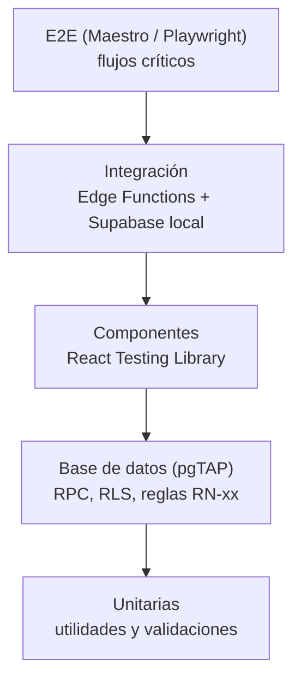

# Plan de Pruebas (QA) — Ekko Rewards

| Campo | Valor |
|---|---|
| Producto | Ekko Rewards |
| Documento | Plan de Pruebas (QA) |
| Versión | 1.1 (verificación de correo con OTP nativo, ADR-14) |
| Fecha | 20 de octubre de 2026 |
| Estado | Borrador para aprobación |
| Documentos base | ekko_prd.md 1.0, ekko_trd.md 1.2, ekko_appflow.md 1.2, ekko_backend.md 1.1, ekko_plan_implementacion.md 1.0 |

---

## 1. Objetivos y alcance

### 1.1 Objetivos

| ID | Objetivo |
|---|---|
| OQ-1 | Que cada regla de negocio RN-01 a RN-73 tenga al menos una prueba automatizada o, si no es automatizable, un caso manual documentado. |
| OQ-2 | Garantizar que ningún cliente ni comercio acceda a datos ajenos (RLS y privilegios por columna). |
| OQ-3 | Asegurar que los flujos de caja (QR y canje) funcionen bajo concurrencia y con mala conexión. |
| OQ-4 | Verificar las metas no funcionales: tamaño, caché, tiempos y compatibilidad. |
| OQ-5 | Llegar a la publicación sin defectos críticos ni altos abiertos. |

### 1.2 Alcance

| Incluido | Excluido |
|---|---|
| App móvil (iOS y Android), panel web, página `/v/:token`, base de datos (RPC, RLS, triggers), Edge Functions, Storage, Realtime, scripts de operación. | Infraestructura interna de Supabase, Expo, Cloudflare, Apple y Google; pruebas de carga a gran escala; pruebas de penetración externas. |

---

## 2. Estrategia de pruebas

Como la lógica de negocio vive en Postgres (ADR-02), la capa de base de datos concentra la mayor parte de las pruebas automatizadas.

| Nivel | Qué se prueba | Herramienta | Responsable | Ejecución |
|---|---|---|---|---|
| Unitarias | Esquemas zod, formateo de fechas y vigencias, cálculo de distribución de sellos, utilidades de imágenes. | Vitest (panel y `shared`), Jest con `jest-expo` (app) | Cada desarrollador | CI en cada PR |
| Base de datos | Cada RPC, cada política RLS, privilegios por columna, triggers, índices únicos, concurrencia. | pgTAP sobre Supabase local | R4 | CI en cada PR |
| Componentes | Estados de pantallas y componentes clave (tarjeta, cupón, Modo Caja, formularios). | React Testing Library / React Native Testing Library | R2, R3 | CI en cada PR |
| Integración | Edge Functions contra Supabase local con Expo Push y SMTP simulados. | `deno test` | R4 | CI en cada PR |
| E2E panel | Flujos del panel en navegador. | Playwright (Chromium y WebKit) | R3 | CI en merge a `develop` |
| E2E app | Flujos de la app en emulador y dispositivo. | Maestro | R2 | Manual por sprint; CI nocturno opcional |
| Manual exploratoria | Flujos completos, usabilidad, casos difíciles de automatizar (cámara real, push real, enlaces universales). | Checklist y dispositivos reales | Todo el equipo (rotativo) | Cada demo y antes de cada release |
| Aceptación (UAT) | Operación real en comercio piloto. | Guiones de la sección 9 | PO y comercios piloto | Beta (S16–S17) |

### 2.1 Metas de cobertura

| Ámbito | Meta |
|---|---|
| Reglas RN-xx | 100% con al menos una prueba (automatizada o manual documentada). |
| RPC públicas e internas | 100% con pruebas pgTAP de caso exitoso y de cada código de error que pueden devolver. |
| Políticas RLS | 100% con pruebas de acceso permitido y denegado por rol. |
| Código TypeScript de lógica (`shared`, hooks, utilidades) | 70% de líneas como mínimo. |
| Flujos críticos E2E | 100% de la sección 5. |

---

## 3. Requisitos de testabilidad

Requisitos que el desarrollo debe cumplir para que el plan sea ejecutable:

| ID | Requisito | Afecta a |
|---|---|---|
| RQ-1 | **Reloj controlable:** todas las funciones usan `app.now()` en lugar de `now()`. En entornos local y de prueba, `app.now()` respeta el ajuste de sesión `app.fake_now`; en staging y producción la función ignora ese ajuste. Permite probar vencimientos de 60 s, 48 h, 30 días, 6 meses, cambios de día y de mes sin esperar. | Backend (sección 3) |
| RQ-2 | **Aleatoriedad controlable en pruebas:** los códigos de cupón aceptan una lista fija (`app.fake_codes`) solo en una sesión SQL directa (local/pgTAP), para probar la colisión de códigos. La ruleta **no** acepta semilla (desviación S14): su sorteo usa rechazo de sesgo sobre `gen_random_bytes` y se verifica por revisión de código y el script de distribución TC-095 (manual); no se justificó duplicar `spin_wheel` solo para inyectar bytes. | Backend |
| RQ-3 | **Identificadores de prueba:** atributos `testID` (app) y `data-testid` (panel) en todos los elementos interactivos de los flujos críticos. | App, panel |
| RQ-4 | **Datos semilla deterministas:** `seed.sql` crea comercios, clientes y estados conocidos (sección 4.2). | Backend |
| RQ-5 | **Servicios externos simulados:** Expo Push, SMTP y API de Apple se reemplazan por dobles en las pruebas de integración. | Edge Functions |
| RQ-6 | **Modo de inyección de QR:** en builds de desarrollo, el escáner acepta un token pegado manualmente para automatizar E2E sin cámara. | App |

---

## 4. Entornos y datos de prueba

### 4.1 Entornos

| Entorno | Uso en QA |
|---|---|
| Local (Supabase CLI) | pgTAP, integración, E2E del panel en CI, desarrollo de pruebas. |
| Staging | Pruebas manuales, E2E de la app en dispositivos, demos, regresión antes de release. |
| Producción | Solo pruebas de humo post-despliegue con el comercio de prueba oculto y cuentas de QA. |

### 4.2 Datos semilla

| Dato | Estado |
|---|---|
| Comercio C1 | Activo y visible; tarjeta de 6 sellos; ruleta con 3 premios (uno de sello extra); beneficio de cumpleaños; menú con 2 categorías y 6 productos; 2 ofertas. |
| Comercio C2 | Activo y visible; tarjeta de 4 sellos; sin beneficio de cumpleaños. |
| Comercio C3 | Inactivo e invisible; con clientes relacionados y cupones vigentes. |
| Comercio C4 (solo producción) | Comercio de prueba oculto para revisión de tiendas y humo. |
| Cliente U1 | Correo verificado, con relación a C1 y 3 sellos. |
| Cliente U2 | Correo sin verificar, sin relaciones. |
| Cliente U3 | Login con Google, cumpleaños en el mes actual, relación con C1 y C2. |
| Cliente U4 | Con un premio de tarjeta disponible en C1 y un cupón de ruleta por vencer. |

### 4.3 Cuentas de QA

Cada entorno remoto tiene cuentas dedicadas de cliente (correo, Google y Apple) y de comercio. Las credenciales viven en el gestor de contraseñas del equipo, nunca en el repositorio.

---

## 5. Flujos críticos E2E

| ID | Flujo | Pasos clave | Herramienta | Prioridad |
|---|---|---|---|---|
| E2E-01 | Primer registro en caja | Registro por correo → cajero genera QR → escaneo → sello → tarjeta visible en Mis Tarjetas. | Maestro + Playwright | Crítica |
| E2E-02 | Visita recurrente | Login → escaneo → "Ya registraste hoy" en segundo intento del mismo día. | Maestro | Crítica |
| E2E-03 | Completar tarjeta y canjear | Cliente con 5 de 6 → escaneo → recompensa → mostrar código → cajero valida → historial. | Maestro + Playwright | Crítica |
| E2E-04 | Ruleta | Agregar tarjeta sin verificar (bloqueada) → verificar → girar → cupón en Mis Tarjetas. | Maestro | Alta |
| E2E-05 | Push con cupón | Comercio desbloquea con PIN → envía push con cupón → cliente lo ve en la pestaña del comercio. | Playwright + manual (push real) | Alta |
| E2E-06 | Bloqueo de PIN | 5 PIN incorrectos → bloqueo de 15 min → regreso a Modo Caja. | Playwright | Alta |
| E2E-07 | Gestión de menú | Crear producto con imagen → marcar agotado → cliente lo ve agotado. | Playwright + Maestro | Media |
| E2E-08 | Comercio inactivo | Comercio inactivo → panel solo valida canjes → cliente ve tarjeta "No disponible". | Playwright + Maestro | Alta |
| E2E-09 | Eliminar cuenta | Eliminar → cerrar sesión → registro con el mismo correo → ruleta ya usada bloqueada. | Maestro | Alta |
| E2E-10 | Enlace universal | QR leído con la cámara nativa con y sin app instalada. | Manual | Alta |

---

## 6. Casos de prueba por módulo

Tipo: **DB** = pgTAP, **UT** = unitaria, **CT** = componente, **INT** = integración, **E2E** = extremo a extremo, **MAN** = manual. Prioridad: **C** crítica, **A** alta, **M** media.

### 6.1 Cuentas y autenticación

| ID | Caso | Resultado esperado | Regla | Tipo | Prio |
|---|---|---|---|---|---|
| TC-001 | Registro con datos válidos. | Cuenta creada, rol `customer`, fila en `customers`, correo de verificación enviado. | RN-01 | INT, E2E | C |
| TC-002 | Registro con fecha que cumple 18 años hoy (hora local). | Aceptado. | RN-03 | DB | A |
| TC-003 | Registro con fecha que cumple 18 años mañana. | E-07. | RN-03 | DB, CT | A |
| TC-004 | Registro con correo existente. | E-20 con opciones de login y recuperación. | — | E2E | M |
| TC-005 | Login con Google o Apple por primera vez. | Se muestra A-04; tras completar, acceso a Explorar; cuenta tratada como verificada. | RN-02, RN-05 | MAN | C |
| TC-006 | Login con correo de relevo de Apple. | Funciona normalmente. | — | MAN | M |
| TC-007 | `complete_profile` intenta cambiar `birth_date` ya fijada. | Fecha sin cambios. | RN-04 | DB | A |
| TC-008 | Usuario `merchant` inicia sesión en la app. | E-19 y cierre de sesión. | — | CT, MAN | A |
| TC-009 | Usuario `customer` inicia sesión en el panel. | E-19. | — | E2E | A |
| TC-010 | El trigger de alta asigna `merchant` solo si viene de la API administrativa. | Un registro público con metadatos manipulados queda como `customer`. | — | DB | C |
| TC-011 | Recuperar contraseña con correo inexistente. | Mismo mensaje genérico que con uno existente. | — | E2E | M |
| TC-012 | Verificación de correo con OTP nativo: código o enlace válido, vencido (después de `otp_expiry`, 1 h), reutilizado, y login con contraseña. | Válido marca `email_verified_at`; vencido y reutilizado se rechazan con opción de reenvío; el login con contraseña no la marca. | RN-05 | INT | A |
| TC-013 | Reenvío del OTP más seguido que la frecuencia por usuario de Supabase Auth. | Rechazado con mensaje de espera. | — | INT | M |
| TC-014 | Inicio de sesión en un segundo dispositivo. | Tarjetas, sellos y cupones idénticos. | RN-06 | MAN | A |
| TC-015 | Contrato de `auth.mfa_amr_claims`: existen las columnas `session_id` y `authentication_method`, y el trigger fija `email_verified_at` solo con `otp`. | La prueba falla si una actualización de Supabase cambia la tabla. | RN-05 | DB | A |

### 6.2 Catálogo y comercio

| ID | Caso | Resultado esperado | Regla | Tipo | Prio |
|---|---|---|---|---|---|
| TC-020 | `list_merchants` con la misma semilla, dos llamadas. | Mismo orden; sin duplicados entre páginas. | RN-52 | DB | A |
| TC-021 | `list_merchants` con semillas distintas. | Orden distinto. | RN-52 | DB | M |
| TC-022 | Comercio invisible en el catálogo. | No aparece. | RN-53 | DB | C |
| TC-023 | Búsqueda parcial y filtro por categoría. | Resultados correctos; combinación de ambos funciona. | RN-51 | DB, E2E | M |
| TC-024 | Detalle de comercio invisible sin relación. | E-05. | RN-53 | DB | A |
| TC-025 | Detalle de comercio invisible con relación. | Se muestra con `available = false`. | RN-71 | DB | A |
| TC-026 | Producto con `sold_out_on` = hoy, ayer y nulo. | Agotado solo el de hoy. | RN-56 | DB | A |
| TC-027 | Cambio de día a las 00:00 en `America/Mexico_City` (reloj simulado). | El producto agotado ayer aparece disponible. | RN-56 | DB | A |
| TC-028 | Enlaces de ubicación y reseña. | Abren Google Maps con la URL del comercio. | RN-54, RN-59 | MAN | M |
| TC-029 | Ver la ficha no crea relación. | Sin fila en `customer_merchants`. | RN-10 | DB | A |

### 6.3 Relación, QR y sellos

| ID | Caso | Resultado esperado | Regla | Tipo | Prio |
|---|---|---|---|---|---|
| TC-040 | `generate_visit_qr` por comercio activo. | Token de 60 s; hash guardado, token en claro no persistido. | RN-13, RN-14 | DB | C |
| TC-041 | Generar un QR nuevo con otro pendiente. | El anterior queda invalidado (E-02 al usarlo). | RN-14 | DB | A |
| TC-042 | Escaneo a los 59 s y a los 61 s (reloj simulado). | Éxito y E-02 respectivamente. | RN-14 | DB | C |
| TC-043 | Mismo token usado por un segundo cliente. | E-03. | RN-14 | DB | C |
| TC-044 | Dos clientes reclaman el mismo token en paralelo. | Exactamente uno obtiene el sello; el otro E-03. | RN-14 | DB (concurrencia) | C |
| TC-045 | Reintento de `claim_visit` por el mismo cliente con el mismo token. | Devuelve el resultado original sin otorgar otro sello. | RR-2 | DB | C |
| TC-046 | Segundo escaneo del mismo cliente el mismo día con otro token. | E-04. | RN-17 | DB | C |
| TC-047 | Escaneo a las 23:59 y a las 00:01 locales. | Ambos válidos (días distintos). | RN-17 | DB | A |
| TC-048 | Escaneo a las 23:59 y a las 00:01 UTC del mismo día local. | El segundo devuelve E-04. | RN-17, RNF-07 | DB | A |
| TC-049 | Primer escaneo sin relación. | Crea relación con `origin = 'first_stamp'` y ciclo nuevo. | RN-10 | DB | A |
| TC-050 | Escaneo en comercio inactivo. | E-05; token no consumido. | RN-71 | DB | A |
| TC-051 | QR de otro dominio o texto arbitrario. | E-08 sin llamar al servidor. | — | CT | M |
| TC-052 | Cada sello registra `granted_at` y se muestra con fecha `dd/mm/aa`. | Correcto en la tarjeta. | RN-19 | DB, CT | M |
| TC-053 | Confirmación en el panel tras el escaneo. | "Visita registrada" en menos de 2 s vía Realtime. | RN-21 | E2E | A |
| TC-054 | Realtime desconectado. | El panel confirma por consulta de respaldo. | RN-21 | E2E | M |
| TC-055 | Panel de otro comercio suscrito al `qr_id` ajeno. | No recibe eventos. | RN-66 | DB, INT | C |
| TC-056 | Escaneo sin conexión. | E-01; reintento con el mismo token si sigue vigente. | RN-20 | MAN | A |
| TC-057 | Solo un comercio activo puede generar QR. | Comercio inactivo recibe E-05. | RN-71 | DB | A |

### 6.4 Ciclo de la tarjeta

| ID | Caso | Resultado esperado | Regla | Tipo | Prio |
|---|---|---|---|---|---|
| TC-070 | Completar 6 de 6. | Ciclo `completed`, cupón de premio con vencimiento a 30 días, ciclo nuevo en 0. | RN-26 | DB | C |
| TC-071 | Aviso "Recompensa disponible" con premio vigente. | Visible con botón "Ver recompensa"; desaparece al canjear o vencer. | RN-27 | CT, E2E | A |
| TC-072 | Premio vence a los 30 días sin canjear. | Cupón no canjeable (E-10); aviso oculto. | RN-28 | DB | A |
| TC-073 | Ciclo vencido (6 meses) con 3 sellos, al abrir la tarjeta. | Ciclo `expired`, nuevo ciclo en 0 con la configuración vigente. | RN-25 | DB | C |
| TC-074 | Ciclo vencido detectado durante `claim_visit`. | Se cierra, se abre uno nuevo y el sello cuenta en el nuevo. | RN-25 | DB | A |
| TC-075 | Comercio cambia de 6 a 8 sellos con un cliente en 5. | El ciclo en curso sigue en 6; el siguiente es de 8. | RN-29 | DB | C |
| TC-076 | Comercio cambia premio y términos. | El ciclo en curso muestra los anteriores. | RN-29 | DB | A |
| TC-077 | `update_card_config` fuera de rango (3 o 11 sellos; 2 o 13 meses). | Rechazado con error de validación. | RN-23, RN-24 | DB, CT | A |
| TC-078 | Distribución de la cuadrícula para 4 a 10 sellos. | Coincide con la tabla del brief (5.1). | — | UT, CT | M |
| TC-079 | Un solo ciclo activo por relación ante llamadas concurrentes. | Índice único impide duplicados. | RN-22 | DB | A |

### 6.5 Ruleta

| ID | Caso | Resultado esperado | Regla | Tipo | Prio |
|---|---|---|---|---|---|
| TC-090 | Giro con relación y correo verificado. | Premio emitido; cupón de 48 h o sello extra pendiente. | RN-31, RN-35 | DB | C |
| TC-091 | Giro con correo sin verificar. | E-06. | RN-05 | DB | C |
| TC-092 | Segundo giro de la misma cuenta. | E-09. | RN-31 | DB | C |
| TC-093 | Giro con otra cuenta en el mismo dispositivo. | E-09. | RN-07 | DB | A |
| TC-094 | Giro tras eliminar la cuenta y registrarse con el mismo correo. | E-09. | RN-09 | DB, E2E | A |
| TC-095 | Distribución de 10,000 giros con pesos 70/20/10 (semilla local). | Frecuencias dentro de ±2 puntos porcentuales. | RN-33 | DB | M |
| TC-096 | `get_wheel` no expone pesos. | Solo índices y etiquetas. | RN-33 | DB | A |
| TC-097 | Un cliente no puede leer `private.wheel_prizes`. | Acceso denegado. | RN-33 | DB | C |
| TC-098 | Sello extra pendiente: siguiente escaneo. | Otorga 2 sellos; ignora el límite diario solo para el extra. | RN-36 | DB | A |
| TC-099 | Sello extra con 5 de 6. | Completa la tarjeta; el excedente se pierde; ciclo nuevo en 0. | RN-36 | DB | A |
| TC-100 | Ruleta pendiente por verificación se habilita al verificar. | La insignia abre la ruleta. | — | E2E | M |

### 6.6 Cupones y canje

| ID | Caso | Resultado esperado | Regla | Tipo | Prio |
|---|---|---|---|---|---|
| TC-110 | Códigos generados usan solo el alfabeto de 31 símbolos. | Sin 0, 1, I, L, O en 10,000 muestras. | RN-38 | DB | A |
| TC-111 | Colisión de código forzada (semilla local). | Se regenera; el índice único se respeta. | RN-38 | DB | M |
| TC-112 | `reveal_coupon_code` de cupón ajeno. | E-12. | RN-38 | DB | C |
| TC-113 | `reveal_coupon_code` sin verificar. | E-06. | RN-05 | DB | C |
| TC-114 | Columna `code` no legible por consulta directa a `coupons`. | Error de privilegios. | RN-38 | DB | C |
| TC-115 | `lookup_redemption` con código de otro comercio. | E-12 (igual que inexistente). | RN-39 | DB | C |
| TC-116 | `lookup_redemption` devuelve nombre completo y beneficio. | Solo esos datos personales. | RN-39 | DB | A |
| TC-117 | Código en minúsculas. | Se normaliza y valida. | — | UT, DB | M |
| TC-118 | 10 códigos inválidos en 5 minutos. | E-13 por 5 minutos; luego se habilita. | RN-40 | DB | C |
| TC-119 | Canje de cupón vencido o usado. | E-10 / E-11. | RN-41 | DB | C |
| TC-120 | Doble confirmación simultánea desde dos tabletas. | Un solo canje; el segundo E-11. | — | DB (concurrencia) | C |
| TC-121 | Canje en comercio inactivo. | Permitido. | RN-71 | DB | A |
| TC-122 | Vigencias: ruleta 48 h, premio 30 días, push 24 o 48 h según el comercio, cumpleaños hasta el último día del mes 23:59:59 local. | Fechas exactas. | PRD 6.6 | DB | A |
| TC-123 | Lista de cupones global y por comercio. | Mismos datos; excluye vencidos y usados. | RN-37 | DB, CT | M |
| TC-124 | Sello y canje en la misma visita. | Ambos permitidos. | RN-41 | DB | M |

### 6.7 Cumpleaños

| ID | Caso | Resultado esperado | Regla | Tipo | Prio |
|---|---|---|---|---|---|
| TC-130 | Apertura en el mes de cumpleaños con 2 relaciones con beneficio y 1 sin beneficio. | 2 cupones. | RN-44 | DB | A |
| TC-131 | Segunda apertura en el mismo mes. | Sin duplicados. | RN-43 | DB | C |
| TC-132 | Apertura fuera del mes. | Ningún cupón. | RN-43 | DB | A |
| TC-133 | Relación con comercio inactivo. | Sin cupón para ese comercio. | RN-71 | DB | M |
| TC-134 | Cumpleaños el 29 de febrero en año no bisiesto. | Cupón emitido en febrero. | RN-43 | DB | M |
| TC-135 | Cupón del año anterior no bloquea el del año actual. | Se emite. | RN-43 | DB | M |

### 6.8 Panel: PIN y sesión administrativa

| ID | Caso | Resultado esperado | Regla | Tipo | Prio |
|---|---|---|---|---|---|
| TC-140 | PIN correcto. | Sesión administrativa de 5 minutos. | RN-62 | DB, E2E | C |
| TC-141 | 4 fallos y luego correcto. | Acceso; contador reiniciado. | RN-63 | DB | A |
| TC-142 | 5 fallos. | E-15 durante 15 minutos; a los 15 min 1 s se permite. | RN-63 | DB | C |
| TC-143 | RPC administrativa sin sesión o con sesión vencida. | E-16. | RN-62 | DB | C |
| TC-144 | Actividad dentro de los 5 minutos extiende la sesión. | Expiración deslizante. | RN-64 | DB | A |
| TC-145 | La sesión administrativa de una tableta no desbloquea otra. | La segunda recibe E-16. | RN-61 | DB | A |
| TC-146 | Inactividad de 5 minutos en el navegador. | Regresa a Modo Caja. | RN-64 | E2E | A |
| TC-147 | Edición en curso cuando vence la sesión. | Se pide PIN y el formulario se conserva. | — | E2E | M |
| TC-148 | `reset-pin.ts` cambia el PIN y reinicia bloqueos. | PIN nuevo funciona. | RN-65 | MAN | M |

### 6.9 Panel: contenido, push y métricas

| ID | Caso | Resultado esperado | Regla | Tipo | Prio |
|---|---|---|---|---|---|
| TC-160 | Subida de imagen JPG de 8 MB. | Variantes WebP ≤ 300 KB; relación correcta. | RN-68 | UT, E2E | A |
| TC-161 | Subida en Safari de iPad. | WebP o respaldo JPEG funcional. | RN-68 | MAN | A |
| TC-162 | Subida a la carpeta de otro comercio. | Rechazada por política de Storage. | — | DB | C |
| TC-163 | Subida sin sesión administrativa. | Rechazada. | RN-62 | DB | A |
| TC-164 | Eliminar categoría con productos. | Rechazado con mensaje. | — | DB | M |
| TC-165 | Producto con categoría de otro comercio. | Rechazado. | — | DB | A |
| TC-166 | Envío de push número 5 y número 6 en el mismo mes local. | Quinto aceptado, sexto E-17. | RN-47 | DB, INT | C |
| TC-167 | Envío el día 1 del mes siguiente (reloj simulado). | Cuota reiniciada. | RN-47 | DB | A |
| TC-168 | Reenvío con la misma clave de idempotencia. | Devuelve la campaña original; no reenvía ni cuenta doble. | — | INT | C |
| TC-169 | Push con cupón a clientes con y sin token. | Todos reciben cupón; solo los que tienen token reciben notificación. | RN-48 | INT | C |
| TC-170 | Respuesta `DeviceNotRegistered` de Expo. | Token desactivado. | — | INT | A |
| TC-171 | Destinatarios: solo clientes con relación activa del comercio. | Ni clientes de otros comercios ni eliminados. | RN-46 | DB | C |
| TC-172 | Recepción en primer plano y en segundo plano; toque abre la pestaña del comercio. | Comportamiento del F-13. | RN-49 | MAN | A |
| TC-173 | Métricas: visitas, canjes y clientes activos con datos semilla conocidos. | Valores exactos; `active_customers` siempre a 30 días. | RN-67 | DB | A |
| TC-174 | Registro de QR sin datos del cliente. | Sin nombres ni IDs de cliente. | RN-66 | DB | C |

### 6.10 Estado del comercio

| ID | Caso | Resultado esperado | Regla | Tipo | Prio |
|---|---|---|---|---|---|
| TC-180 | Comercio inactivo: generar QR, enviar push, editar menú, desbloquear PIN. | Todo rechazado con E-05. | RN-71 | DB | C |
| TC-181 | Comercio inactivo: validar canje. | Permitido. | RN-71 | DB | C |
| TC-182 | Cliente con relación a comercio inactivo. | Tarjeta "No disponible", sin sellos nuevos; cupones canjeables. | RN-71 | CT, E2E | A |
| TC-183 | Reactivación. | Sellos, ciclos y cupones intactos. | RN-72 | DB | A |
| TC-184 | Vista `merchants_billing` con fechas de corte conocidas. | Lista correcta de por vencer y en gracia. | RN-70 | DB | M |

### 6.11 Eliminación de cuenta y privacidad

| ID | Caso | Resultado esperado | Regla | Tipo | Prio |
|---|---|---|---|---|---|
| TC-190 | Eliminación con confirmación "ELIMINAR". | Datos personales nulos, tokens borrados, cupones activos eliminados, usuario de Auth eliminado. | RN-08 | INT | C |
| TC-191 | Confirmación incorrecta. | Rechazada. | — | INT | M |
| TC-192 | Cuenta de Apple: reautenticación y revocación (API simulada). | Revocación invocada con el código. | RN-08 | INT, MAN | A |
| TC-193 | Historial anonimizado. | Sellos y canjes conservados sin datos personales. | RN-08 | DB | A |
| TC-194 | Registro nuevo con el mismo correo. | Cuenta nueva, sin tarjetas previas. | RN-09 | E2E | A |
| TC-195 | Hashes guardados con pimienta, no reversibles por SHA-256 simple del valor. | El hash difiere del SHA-256 sin pimienta. | RN-08 | DB | A |

### 6.12 Seguridad y aislamiento (RLS)

| ID | Caso | Resultado esperado | Tipo | Prio |
|---|---|---|---|---|
| TC-200 | Cliente A consulta tarjetas, sellos, cupones y perfil de cliente B. | Cero filas. | DB | C |
| TC-201 | Comercio A consulta tokens QR, campañas y productos de comercio B (no visibles). | Cero filas. | DB | C |
| TC-202 | Comercio intenta leer `customers`, `stamps` o `coupons`. | Cero filas o error. | DB | C |
| TC-203 | Rol `anon` consulta cualquier tabla o RPC protegida. | Denegado. | DB | C |
| TC-204 | Cualquier `INSERT`/`UPDATE`/`DELETE` directo a tablas transaccionales con JWT de cliente o comercio. | Denegado. | DB | C |
| TC-205 | Acceso a esquemas `private` y `app` vía API. | No expuestos. | DB | C |
| TC-206 | Inventario automático: toda tabla de `public` tiene RLS habilitado. | Prueba que falla si se agrega una tabla sin RLS. | DB | C |
| TC-207 | Toda función `SECURITY DEFINER` tiene `search_path` fijo. | Prueba de inventario. | DB | A |
| TC-208 | Escaneo de secretos en el repositorio y en el bundle de la app y del panel. | Sin `service_role` ni llaves privadas. | MAN (CI con herramienta de escaneo) | C |
| TC-209 | Auditoría de dependencias (`pnpm audit`). | Sin vulnerabilidades altas o críticas sin justificar. | CI | A |
| TC-210 | Cabeceras de seguridad del panel. | CSP, `X-Frame-Options` y `Referrer-Policy` presentes. | MAN | M |

---

## 7. Pruebas no funcionales

### 7.1 Rendimiento

| ID | Prueba | Meta | Herramienta |
|---|---|---|---|
| NF-01 | Tiempo de servidor de `claim_visit`. | p95 < 300 ms. | `EXPLAIN ANALYZE` y medición en staging. |
| NF-02 | 50 `claim_visit` concurrentes sobre 50 tokens distintos. | Sin errores; p95 < 500 ms. | Script de carga ligera (k6). |
| NF-03 | Registro de visita de extremo a extremo en 4G. | < 3 s desde la lectura hasta la confirmación. | Medición manual con cronómetro (5 repeticiones). |
| NF-04 | Primera carga de Explorar. | Contenido visible < 2 s en Wi-Fi. | Medición manual. |
| NF-05 | Carga del panel en tableta. | Modo Caja usable < 3 s. | Lighthouse. |

### 7.2 Tamaño y almacenamiento

| ID | Prueba | Meta |
|---|---|---|
| NF-10 | Tamaño de descarga reportado por App Store Connect y Google Play Console. | < 25 MB (meta monitoreada; alerta si crece > 10%). |
| NF-11 | Caché tras navegar 30 comercios con todas sus imágenes. | ≤ 20 MB en disco. |
| NF-12 | Almacenamiento total de la app tras una semana de uso simulado. | ≤ 40 MB. |

### 7.3 Compatibilidad

| Plataforma | Dispositivos mínimos | Dispositivos de referencia |
|---|---|---|
| iOS | iPhone con iOS 15 (por ejemplo, iPhone 7 o 8). | iPhone reciente con la última versión de iOS. |
| Android | Equipo de gama baja con Android 8 y 2 GB de RAM. | Android de gama media reciente (Samsung o Motorola, comunes en la región). |
| Pantallas | 360 × 640 dp; iPhone SE. | 390 × 844 pt. |
| Panel | Safari de iPad, Chrome en tableta Android, Chrome y Edge en Windows. | — |

### 7.4 Accesibilidad

Checklist por pantalla: contraste AA, etiquetas accesibles en botones de ícono, escalado de fuente al 130%, lectura correcta con VoiceOver y TalkBack en tarjeta, cupón y código, áreas táctiles de 44 pt, respeto de "reducir movimiento". Responsable: R1 en S14.

### 7.5 Usabilidad en caja

Durante la beta: medir con 10 clientes reales el tiempo desde que el cajero cobra hasta "Visita registrada". Meta: mediana menor a 15 s para clientes con la app instalada.

---

## 8. Gestión de defectos

### 8.1 Severidades

| Severidad | Definición | Ejemplos | Tiempo de corrección |
|---|---|---|---|
| Crítica | Pérdida o exposición de datos, fraude posible o bloqueo total de un flujo de caja. | Sellos duplicados, cliente ve datos de otro, el QR no se puede escanear. | Inmediato; bloquea release. |
| Alta | Una regla de negocio no se cumple o un flujo principal falla sin alternativa. | Vigencia mal calculada, push no llega, PIN no bloquea. | En el sprint en curso; bloquea release. |
| Media | Falla con alternativa o afecta un flujo secundario. | Filtro incorrecto, error de texto con impacto funcional. | Siguiente sprint. |
| Baja | Cosmético o mejora. | Alineación, tipografía. | Según prioridad del PO. |

### 8.2 Proceso

- Los defectos se registran en GitHub Issues con la etiqueta de severidad, el entorno, la versión, los pasos, el resultado esperado y el obtenido, y capturas o video.
- Todo defecto crítico o alto corregido incluye una prueba automatizada que lo reproduce (regresión).
- Los errores de Sentry nuevos en staging se revisan en cada demo.

---

## 9. Pruebas de aceptación con comercios piloto (UAT)

| ID | Guion | Ejecuta | Criterio de aceptación |
|---|---|---|---|
| UAT-01 | Registrar 10 visitas reales en un día. | Cajero del piloto | Sin errores; el cajero lo hace sin ayuda tras la capacitación. |
| UAT-02 | Canjear 3 premios o cupones. | Cajero | Código validado en menos de 30 s. |
| UAT-03 | Cambiar un producto a agotado y verlo en la app. | Dueño | Cambio visible en la app al refrescar. |
| UAT-04 | Enviar una notificación con cupón. | Dueño | Llega a los clientes y se canjea al menos un cupón. |
| UAT-05 | Consultar métricas al final de la semana. | Dueño | Cifras coherentes con lo observado. |
| UAT-06 | Primer registro de un cliente nuevo en caja. | Cliente real | Registrado y con sello en menos de 3 minutos. |

Al final de la beta se aplica una encuesta breve al dueño y a 2 cajeros (facilidad de uso del 1 al 5 y comentarios abiertos).

---

## 10. Criterios de entrada y salida

| Etapa | Criterio de entrada | Criterio de salida |
|---|---|---|
| Historia de usuario | Definition of Ready. | Definition of Done (Plan de Implementación 2.4). |
| Release a staging | CI verde. | Prueba de humo de staging aprobada. |
| H4 — Candidato a lanzamiento | Funcionalidad completa (H3). | 100% de casos C y A ejecutados y aprobados; 0 defectos críticos o altos abiertos; NF-01 a NF-12 dentro de meta o con excepción aprobada; checklist de accesibilidad aprobado. |
| Publicación (H5) | Beta de 14 días completada. | UAT-01 a UAT-06 aprobados; sin defectos críticos o altos nuevos durante la beta; tareas legales y de tiendas cerradas. |

---

## 11. Regresión y pruebas de humo

### 11.1 Regresión automatizada

Todo el conjunto pgTAP, unitarias, componentes e integración se ejecuta en cada PR. Los E2E del panel se ejecutan en cada merge a `develop`.

### 11.2 Prueba de humo (15 minutos, manual)

Se ejecuta en staging antes de cada release y en producción tras cada despliegue, con cuentas de QA y el comercio de prueba:

1. Iniciar sesión en la app y en el panel.
2. Abrir Explorar y el detalle de un comercio.
3. Generar QR y registrar una visita.
4. Mostrar el código de un cupón y validarlo en el panel.
5. Desbloquear la sección administrativa con PIN y abrir métricas.
6. Revisar Sentry: sin errores nuevos.

---

## 12. Responsabilidades

| Actividad | R1 | R2 | R3 | R4 | PO |
|---|---|---|---|---|---|
| Pruebas pgTAP e integración | — | — | — | Responsable | — |
| Pruebas unitarias y de componentes | — | Responsable (app) | Responsable (panel) | Responsable (shared) | — |
| E2E app (Maestro) | — | Responsable | — | Apoyo | — |
| E2E panel (Playwright) | — | — | Responsable | Apoyo | — |
| QA visual y accesibilidad | Responsable | Apoyo | Apoyo | — | — |
| Pruebas no funcionales | — | NF-03, NF-10 a NF-12 | NF-05 | NF-01, NF-02 | — |
| Prueba de humo | Rotativo | Rotativo | Rotativo | Rotativo | Aprueba |
| UAT | Apoyo | Apoyo | Apoyo | Apoyo | Responsable |
| Aprobación de release | — | — | — | Aprueba | Aprueba |

---

## 13. Anexo: matriz de cobertura (S14)

Archivos en `supabase/tests/` (pgTAP salvo indicación): 04 `04_auth`, 06 `06_customer_account`, 07 `07_catalog`, 08 `08_merchant_detail`, 09 `09_visit_qr`, 10 `10_claim_visit`, 12 `12_card_rules`, 13 `13_redemption`, 14 `14_wheel`, 15 `15_admin_unlock`, 16 `16_card_config`, 17 `17_storage`, 18 `18_birthday`, 20 `20_menu`, 21 `21_offers_push`, 22 `22_metrics_delete`, 03 `03_app_functions`, 02 `02_schema`, 00 `00_inventory`, 23 `23_security_audit`, 24 `24_qa_gaps`, C = `concurrency/*.sh`. "app"/"panel" = pruebas de componentes/E2E de esas apps; "manual" = dispositivo real o servicio externo.

| Casos | Cobertura |
|---|---|
| TC-001, 010, 015 | 04 (el correo de verificación: manual) |
| TC-002, 003, 007 | 06 |
| TC-004, 009, 011 | panel / app (E2E) |
| TC-005, 006, 014, 028, 056, 148, 161, 172 | manual |
| TC-008 | 06, 11 (E-19) + app |
| TC-012 | 04 (disparador OTP) + manual (vencido/reutilizado) |
| TC-013, 170, 190, 191, 192 | integración de Edge Functions (`scripts/*.test.ts`) / manual |
| TC-020 a 023, 024 a 027, 029 | 07, 08 |
| TC-040 a 043, 045 a 050, 057, 070, 074, 098, 099 | 09, 10 |
| TC-044 | C (`tc044_claim_visit.sh`) |
| TC-051, 071, 078, 123, 182 | app (componentes/E2E) |
| TC-052 | 10 |
| TC-053, 054, 146, 147, 100, 194 | panel / app (E2E) |
| TC-055, 201 | 07, 09 (el comercio solo ve sus tokens) |
| TC-072, 119 | 13 |
| TC-073, 075, 076, 079 | 08, 12 |
| TC-077 | 16 |
| TC-090 a 094, 096 | 14 |
| TC-095 | manual (distribución de 10,000 giros: no automatizable en pgTAP, un giro por cuenta; ver RQ-2) |
| TC-097, 200, 202 | 24, 23 |
| TC-110, 195 | 03 |
| TC-111 | 24 (con `app.fake_codes`) |
| TC-112 a 118 | 13 |
| TC-114, 203 a 207 | 13, 14, 00, 23 |
| TC-120 | 24 + C (`tc120_confirm_redemption.sh`) |
| TC-121, 181 | 24 |
| TC-122 | 10 (30 días), 14 (48 h), 21 (24/48 h), 18 (fin de mes) |
| TC-124 | manual (sello y canje son RPC independientes; sin dependencia entre ellos) |
| TC-130 a 133, 135 | 18 |
| TC-131, 134 | 18, 24 |
| TC-140 a 145 | 15 |
| TC-160 | app/panel (pruebas unitarias de imagen) |
| TC-162, 163 | 16, 17 |
| TC-164, 165 | 20 |
| TC-166 a 169, 171 | 21, 22 |
| TC-173, 174, 184, 193 | 22 |
| TC-180 | 09, 16, 20, 21, 24 |
| TC-183 | 24 |
| TC-208, 209 | CI / `pnpm audit` |
| TC-210 | manual |
| NF-01 a 05, 10 a 12 | medición manual / k6 / Lighthouse (no ejecutadas aún) |

Cambios y hallazgos de S14:
- TC-180: `unlock_admin` se permite con comercio inactivo por diseño (el validador sigue disponible, backend §4.5); las RPC de escritura sí rechazan con E-05. El caso se lee así: "generar QR, enviar push y editar menú rechazados con E-05; el desbloqueo de PIN se permite".
- TC-120: defecto Alta corregido en `s14_hardening`; el reintento idempotente de `confirm_redemption` ahora exige la misma sesión de Auth, otra tableta recibe E-11.
