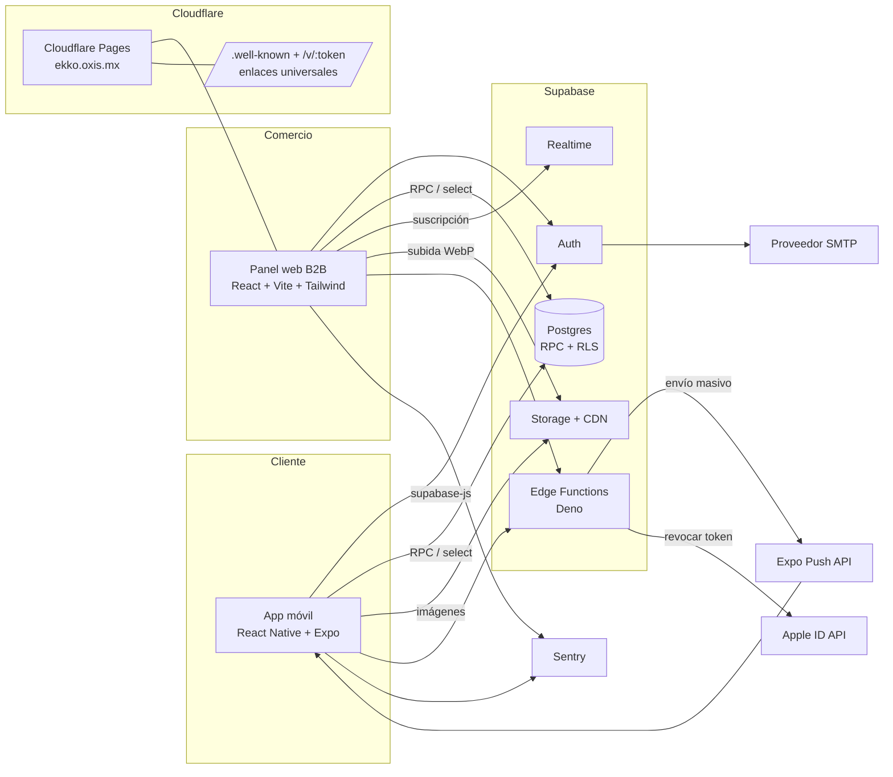
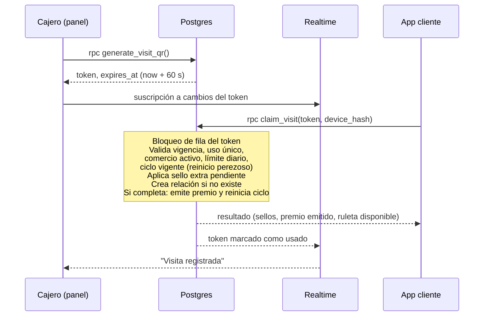
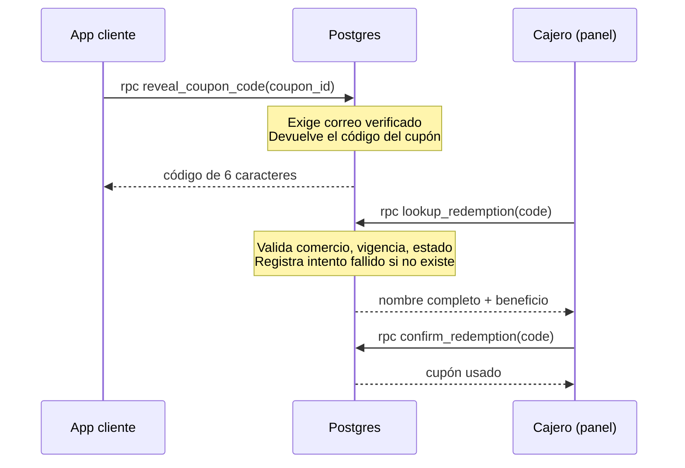

# TRD — Ekko Rewards

| Campo | Valor |
|---|---|
| Producto | Ekko Rewards |
| Documento | Technical Requirements Document (TRD) |
| Versión | 1.2 (resultados de Sprint 0: docs/ekko_spikes.md; elimina la Edge Function `email-verification`, ADR-14) |
| Fecha | 20 de octubre de 2026 |
| Estado | Borrador para aprobación |
| Documento base | ekko_prd.md v1.0 (las referencias RN-xx, US-xx y RNF-xx apuntan a él) |

---

## 1. Principios de arquitectura

| ID | Principio | Consecuencia técnica |
|---|---|---|
| PA-1 | Servidor como fuente de verdad | Toda regla de negocio crítica se ejecuta en funciones de Postgres (RPC). Los clientes nunca escriben directamente en tablas transaccionales. |
| PA-2 | Seguridad en la base de datos | Row Level Security (RLS) habilitado en todas las tablas expuestas. |
| PA-3 | Sin procesos programados | Vencimientos, reinicios y cupones de cumpleaños se resuelven de forma perezosa (al leer o al operar), sin cron. |
| PA-4 | Cliente ultraligero | Sin assets embebidos de comercios, dependencias mínimas, carga bajo demanda. |
| PA-5 | Costo inicial mínimo | Capas gratuitas en desarrollo y staging; Supabase Pro solo en producción. |
| PA-6 | Un solo lenguaje | TypeScript en app, panel, Edge Functions y paquete compartido; SQL en la base de datos. |

---

## 2. Arquitectura del sistema

### 2.1 Vista de componentes



### 2.2 Responsabilidades por capa

| Capa | Responsabilidad | No hace |
|---|---|---|
| App móvil | UI del cliente, cámara, sesión, caché de imágenes, registro del token push y del `device_id`. | Validar reglas de negocio, generar códigos, calcular premios. |
| Panel web | UI del comercio, generación visual del QR, validador, CRUD, compresión de imágenes. | Decidir vigencias, cuotas o validez de códigos. |
| Postgres (RPC) | Lógica transaccional: QR, sellos, ciclos, ruleta, cupones, canjes, PIN, cuotas de push, métricas. | Llamadas a servicios externos. |
| Edge Functions | Integraciones externas: envío push (Expo), revocación de Apple, eliminación de cuenta en Auth. | Reglas de negocio que puedan vivir en SQL. |
| Storage | Imágenes públicas de comercios en variantes WebP prerredimensionadas. | Transformaciones al vuelo (requieren plan Pro). |
| Cloudflare Pages | Hosting del panel, página pública `/v/:token` y archivos de enlaces universales. | Lógica de servidor. |

### 2.3 Flujo crítico: registro de visita (RN-13 a RN-21)



### 2.4 Flujo crítico: canje (RN-37 a RN-41)



---

## 3. Stack tecnológico

Las versiones exactas se fijan en el repositorio al iniciar el proyecto, usando la versión estable vigente de cada herramienta.

### 3.1 App móvil

| Necesidad | Tecnología | Notas |
|---|---|---|
| Framework | React Native + Expo (SDK estable vigente), TypeScript estricto | Motor Hermes, nueva arquitectura habilitada. |
| Navegación | Expo Router | Tabs inferiores: Explorar, Mis Tarjetas, Perfil. Rutas para deep links `/v/:token`. |
| Datos del servidor | `@supabase/supabase-js` + TanStack Query | Caché en memoria, paginación infinita, invalidación tras RPC. |
| Estado local | Contexto de React (sesión) | Sin librería de estado global adicional. |
| Sesión segura | `expo-secure-store` como almacenamiento de sesión de Supabase | — |
| Escáner QR | `expo-camera` (escaneo de códigos integrado) | Sin librerías de escaneo adicionales. |
| Imágenes | `expo-image` | Caché en disco; tope de 20 MB sujeto al spike SP-1. |
| Login con Google | Google Sign-In nativo con intercambio de ID token en Supabase | `@react-native-google-signin/google-signin` (Original) + `signInWithIdToken` (SP-4). Plan B: `signInWithOAuth` + `expo-web-browser` (PKCE). |
| Login con Apple | `expo-apple-authentication` | Obligatorio en iOS al ofrecer login social. |
| Notificaciones | `expo-notifications` | Registro del Expo Push Token por dispositivo. |
| Identificador de dispositivo | `expo-application` (ID de proveedor en iOS, Android ID en Android) | Se envía solo como hash SHA-256 con sal del proyecto (RN-07). |
| Formularios y validación | `react-hook-form` + `zod` | Esquemas compartidos con el panel. |
| Errores | `@sentry/react-native` | Capa gratuita. |
| Build y distribución | EAS Build, EAS Submit, EAS Update | Canales por entorno; build local como respaldo si se agota la capa gratuita. |

### 3.2 Panel web

| Necesidad | Tecnología | Notas |
|---|---|---|
| Framework | React + Vite, TypeScript estricto | SPA estática, sin SSR. |
| Estilos | Tailwind CSS | Diseño responsivo PC y tableta. |
| Enrutamiento | React Router | Ruta raíz = Modo Caja. |
| Datos | `@supabase/supabase-js` + TanStack Query | — |
| Tiempo real | Supabase Realtime | Confirmación de escaneo (RN-21). |
| QR | Generación en cliente a partir del token (librería ligera de QR en SVG) | — |
| Imágenes | Compresión y conversión a WebP con Canvas; respaldo a JPEG si el navegador no codifica WebP | Validación en Safari de iPad (spike SP-5). |
| Formularios | `react-hook-form` + `zod` | — |
| Errores | `@sentry/react` | — |
| Hosting | Cloudflare Pages | Previews por rama. |

### 3.3 Backend

| Necesidad | Tecnología | Notas |
|---|---|---|
| Base de datos | Supabase Postgres | Zona horaria de cálculo `America/Mexico_City`. |
| Lógica de negocio | Funciones PL/pgSQL expuestas como RPC | `SECURITY DEFINER` con `search_path` fijo; validan `auth.uid()` y rol. |
| Autorización | RLS + claim de rol en `app_metadata` (`customer` / `merchant`) | El rol lo asigna solo el servidor. |
| Autenticación | Supabase Auth: correo, Google, Apple | SMTP externo (RNF-11). Verificación de correo con OTP nativo y trigger (ADR-14). |
| Archivos | Supabase Storage, bucket público de lectura | Escritura restringida por ruta `{merchant_id}/...`. |
| Integraciones | Supabase Edge Functions (Deno, TypeScript) | Solo: `send-push` y `delete-account`. |
| Aleatoriedad | `gen_random_bytes` de `pgcrypto` | Tokens QR, códigos de canje y giro de ruleta. |
| Hash de PIN | `crypt()` con bcrypt de `pgcrypto` | — |
| Migraciones | Supabase CLI, migraciones SQL versionadas | Sin cambios manuales de esquema en staging ni producción. |
| Tipos | `supabase gen types typescript` | Publicados en el paquete compartido. |

### 3.4 Servicios externos

| Servicio | Uso | Costo previsto |
|---|---|---|
| Supabase | Base de datos, Auth, Storage, Realtime, Edge Functions | Gratis (dev/staging); Pro 25 USD/mes en producción antes del primer comercio de pago. |
| Cloudflare Pages | Panel, `/v/:token`, `.well-known` | Gratis; permite uso comercial. |
| Expo (EAS + Push API) | Builds, envío a tiendas, OTA, notificaciones | Capa gratuita; build local como respaldo. |
| SMTP (Resend, ADR-09) | Verificación y recuperación de contraseña | Capa gratuita. |
| Sentry | Monitoreo de errores | Capa gratuita. |
| Apple Developer | Publicación iOS y Apple Sign-In | 99 USD/año. |
| Google Play Console | Publicación Android | 25 USD pago único. |

---

## 4. Estructura del repositorio

Monorepo independiente en GitHub con pnpm workspaces.

```text
ekko/
├── apps/
│   ├── mobile/                 # Expo (app.config.ts con APP_VARIANT)
│   └── panel/                  # React + Vite (incluye /v y .well-known en public/)
├── packages/
│   └── shared/                 # Tipos generados, esquemas zod, constantes de reglas
├── supabase/
│   ├── migrations/             # SQL versionado
│   ├── functions/              # Edge Functions: send-push, delete-account
│   ├── seed.sql                # Datos de desarrollo
│   └── tests/                  # Pruebas de RPC y RLS (pgTAP)
├── scripts/
│   ├── onboard-merchant.ts     # Alta de comercio (US-27)
│   ├── set-merchant-status.ts  # Estado de suscripción (US-28)
│   └── reset-pin.ts            # Restablecimiento de PIN (RN-65)
├── .github/workflows/          # CI/CD
└── docs/                       # PRD, TRD, ADR y demás entregables
```

`packages/shared` concentra las constantes que deben coincidir en app, panel y SQL (rango de sellos, vigencias, longitud de códigos, alfabeto). Los valores autoritativos viven en la base de datos; el paquete los replica solo para validación de formularios y textos de UI.

---

## 5. Entornos

| Atributo | Desarrollo | Staging | Producción |
|---|---|---|---|
| Supabase | Local con Supabase CLI (Docker) | Proyecto en capa gratuita | Proyecto en plan Pro |
| Respaldos | No aplica | No (se acepta) | Automáticos diarios (Pro) |
| Pausa por inactividad | No aplica | Posible (se acepta) | No |
| Panel | `localhost` (Vite) | `staging.ekko.oxis.mx` | `ekko.oxis.mx` |
| Bundle ID / package | `mx.oxis.ekko.dev` | `mx.oxis.ekko.staging` | `mx.oxis.ekko` |
| Canal EAS | `development` | `staging` | `production` |
| Distribución app | Dev client | Distribución interna / prueba cerrada | App Store y Google Play |
| Rama Git | ramas de trabajo | `develop` | `main` |
| SMTP | Inbucket local de Supabase CLI | Proveedor SMTP (dominio de pruebas) | Proveedor SMTP (dominio `oxis.mx`) |
| Expo Push | Sí (dispositivos de desarrollo) | Sí | Sí |

Reglas:
- Las migraciones se aplican primero a staging y luego a producción, siempre desde CI.
- Las variables y secretos de cada entorno viven en GitHub Actions, EAS y Cloudflare Pages; nunca en el repositorio.
- La `service_role key` solo existe en Edge Functions y en los scripts de operación ejecutados por Oxis.

### 5.1 DNS

El DNS de `oxis.mx` se administra en Cloudflare. Se crean dos dominios personalizados en Cloudflare Pages: `ekko.oxis.mx` (rama `main`) y `staging.ekko.oxis.mx` (rama `develop`). Para el SMTP de producción se agregan los registros SPF, DKIM y DMARC del proveedor elegido.

---

## 6. Seguridad y autenticación

### 6.1 Modelo de identidad

| Actor | Mecanismo | Rol en JWT |
|---|---|---|
| Cliente | Supabase Auth: correo y contraseña, Google o Apple | `app_metadata.role = 'customer'` (asignado por trigger al crear el usuario) |
| Comercio | Supabase Auth: correo y contraseña creados por script | `app_metadata.role = 'merchant'` y `app_metadata.merchant_id` |
| Oxis | `service_role` en scripts y Supabase Studio | — |

- Los comercios no pueden registrarse desde la app ni el panel: el registro público solo crea clientes.
- Un usuario con rol `merchant` no puede iniciar sesión en la app móvil, y viceversa (validación en cliente y en RLS).

### 6.2 Reglas de autorización

| Recurso | Cliente | Comercio | Mecanismo |
|---|---|---|---|
| Catálogo, menú, ofertas de comercios visibles | Lectura | Lectura de los propios | RLS |
| Tarjetas, sellos, cupones propios | Lectura | Sin acceso a filas individuales | RLS |
| Sellos, ciclos, cupones, canjes, ruleta | Solo vía RPC | Solo vía RPC | Sin políticas de escritura directa |
| Menú, ofertas, configuración de tarjeta | — | Escritura vía RPC con desbloqueo de PIN | RPC + verificación de sesión administrativa |
| Métricas y registro de QR | — | Lectura vía RPC con desbloqueo de PIN | RPC |
| Pesos de ruleta, estado de suscripción, PIN | — | — | Solo `service_role` |

### 6.3 PIN y sesión administrativa (RN-62 a RN-65)

- El PIN se guarda con hash bcrypt.
- `unlock_admin(pin)` registra intentos fallidos por comercio. Con 5 fallos consecutivos fija `locked_until = now() + 15 min`.
- Un desbloqueo exitoso crea un registro de sesión administrativa ligado a la sesión de Auth del dispositivo, con expiración deslizante de 5 minutos. Cada RPC administrativa verifica y extiende la expiración.
- El panel también vuelve a Modo Caja tras 5 minutos sin interacción (temporizador en cliente). El servidor es la autoridad.

### 6.4 QR de visita (RN-13 a RN-16)

| Aspecto | Especificación |
|---|---|
| Token | 128 bits aleatorios codificados en base64url. |
| Contenido del QR | `https://ekko.oxis.mx/v/<token>` (staging: `https://staging.ekko.oxis.mx/v/<token>`). |
| Vigencia | `expires_at = now() + interval '60 seconds'`. |
| Uso único | `claim_visit` bloquea la fila (`FOR UPDATE`) y fija `used_at` y `used_by`. |
| Generación | Solo usuarios `merchant` de comercios activos. Un nuevo QR invalida el anterior pendiente del mismo comercio. |
| Bitácora | Cada token queda registrado (generado, usado, vencido) para el registro de QR del panel. |

### 6.5 Códigos de canje (RN-38 a RN-40)

| Aspecto | Especificación |
|---|---|
| Formato | 6 caracteres del alfabeto `23456789ABCDEFGHJKMNPQRSTUVWXYZ` (31 símbolos, sin 0, 1, I, L, O). |
| Generación | En el servidor al emitir el cupón; único entre cupones vigentes del mismo comercio. |
| Revelación | `reveal_coupon_code` exige correo verificado (RN-05). |
| Validación | `lookup_redemption` solo resuelve códigos del comercio autenticado. |
| Antiadivinación | 10 intentos fallidos en 5 minutos bloquean el validador del comercio durante 5 minutos. |

### 6.6 Protección de datos personales

- El comercio solo recibe nombre completo y beneficio en `lookup_redemption` (RN-39). Ninguna otra RPC del comercio devuelve datos personales.
- `device_id` y correo de cuentas eliminadas se guardan solo como hash SHA-256 con sal (pepper) almacenada como secreto.
- Eliminación de cuenta (Edge Function `delete-account`):
  1. RPC de anonimización: borra nombre, fecha de nacimiento y tokens push; guarda el hash del correo y de los dispositivos.
  2. Revoca el token de Apple si el proveedor es Apple.
  3. Elimina el usuario de Supabase Auth, lo que permite volver a registrarse con el mismo correo (RN-09).
  4. El historial (sellos, canjes, giros) queda ligado a un identificador anónimo.

### 6.7 Otros controles

- Validación de edad (18+) y de datos en el servidor, además del cliente.
- Límites de intentos de Supabase Auth activos; CAPTCHA de Auth evaluado si se detecta abuso (fuera del MVP).
- Cabeceras de seguridad en Cloudflare Pages (`_headers`): CSP, `X-Frame-Options`, `Referrer-Policy`.
- Ningún secreto en la app ni en el panel: solo la `anon key` y la URL del proyecto.

---

## 7. Lógica de negocio en servidor

### 7.1 Inventario de RPC

| RPC | Actor | Reglas | Descripción |
|---|---|---|---|
| `complete_profile` | Cliente | RN-01 a RN-04 | Guarda nombre y fecha de nacimiento; valida 18+; bloquea edición posterior de la fecha. |
| `register_device` | Cliente | RN-07, RN-49 | Registra hash de dispositivo y Expo Push Token. |
| `list_merchants` | Cliente | RN-51 a RN-53 | Catálogo paginado con semilla aleatoria por sesión, búsqueda y categoría. |
| `get_merchant_detail` | Cliente | US-08 | Ficha, tarjeta (con reinicio perezoso), menú, ofertas y cupones del comercio. |
| `add_card` | Cliente | RN-10 | Crea la relación. |
| `claim_visit` | Cliente | RN-13 a RN-29, RN-36 | Registro atómico de visita. |
| `spin_wheel` | Cliente | RN-31 a RN-36 | Giro ponderado en servidor; emite cupón o sello extra. |
| `ensure_birthday_coupons` | Cliente | RN-43 a RN-45 | Generación perezosa e idempotente. |
| `list_my_cards`, `list_my_coupons` | Cliente | RN-37 | Vistas de "Mis Tarjetas". |
| `reveal_coupon_code` | Cliente | RN-38 | Devuelve el código si el correo está verificado. |
| `generate_visit_qr` | Comercio | RN-13, RN-14 | Crea token de 60 s. |
| `lookup_redemption`, `confirm_redemption` | Comercio | RN-39 a RN-41, RN-71 | Validador de canjes (permitido aun con comercio inactivo). |
| `unlock_admin` | Comercio | RN-62 a RN-64 | Desbloqueo con PIN. |
| `update_card_config` | Comercio | RN-23, RN-24, RN-29 | Configuración para ciclos nuevos. |
| `upsert_product`, `delete_product`, `set_product_flags` | Comercio | RN-55 a RN-57 | CRUD de menú. |
| `upsert_offer`, `delete_offer` | Comercio | RN-58 | Ofertas semanales. |
| `create_push_campaign` | Edge Function | RN-46 a RN-48 | Valida cuota y crea campaña y cupones en una transacción. |
| `get_metrics`, `list_qr_log` | Comercio | RN-66, RN-67 | Métricas agregadas y bitácora. |

### 7.2 Resolución perezosa (PA-3)

| Evento | Momento de evaluación | Mecanismo |
|---|---|---|
| Vencimiento del ciclo de tarjeta | Al leer la tarjeta o al registrar visita | Si `cycle.expires_at < now()`, se cierra y se abre un ciclo nuevo con la configuración vigente. |
| Vencimiento de cupones | Al leer o canjear | Estado derivado de `expires_at`; no se actualizan filas. |
| Cupón de cumpleaños | Al abrir la app | `ensure_birthday_coupons` con clave única (cliente, comercio, año). |
| "Agotado por hoy" | Al leer el menú | Se guarda `sold_out_on` (fecha); se considera agotado solo si es igual a la fecha actual en `America/Mexico_City`. |
| Límite diario de sellos | Al registrar visita | Restricción única (cliente, comercio, fecha local). |
| Cuota mensual de push | Al crear campaña | Conteo por mes calendario local. |
| Periodo de gracia | Operación Oxis | Script lista comercios vencidos; el cambio de estado es manual (RN-70). |

### 7.3 Ruleta

- Los premios y pesos se guardan por comercio en una tabla editable solo por `service_role`.
- Selección: número aleatorio de `gen_random_bytes` sobre la suma de pesos.
- Restricciones únicas: (cliente, comercio) y (hash de dispositivo, comercio); y verificación contra hashes de correo de cuentas eliminadas (RN-09).

### 7.4 Notificaciones push

1. El panel invoca la Edge Function `send-push` con el JWT del comercio.
2. La función llama a `create_push_campaign`, que valida el desbloqueo administrativo, la cuota (5 por mes), crea la campaña y, si aplica, un cupón por destinatario en una sola transacción.
3. La función obtiene los tokens de los destinatarios y envía a Expo Push API en lotes de hasta 100 mensajes.
4. Los tickets con error `DeviceNotRegistered` desactivan el token de inmediato.
5. El resultado del envío (enviados, fallidos) se guarda en la campaña y se muestra en el panel.

La consulta diferida de receipts de Expo queda fuera del MVP; los tokens inválidos se depuran con los tickets de cada envío.

---

## 8. Medios e imágenes

### 8.1 Variantes generadas en el panel

| Tipo | Variantes (ancho en px) | Relación | Calidad WebP |
|---|---|---|---|
| Logo | 128, 256 | 1:1 | 0.85 |
| Portada | 540, 1080 | 16:9 | 0.80 |
| Fondo de tarjeta | 540, 1080 | 1.586:1 (tarjeta) | 0.80 |
| Producto | 360, 720 | 1:1 | 0.80 |
| Oferta | 540, 1080 | 16:9 | 0.80 |

- Peso máximo aceptado del archivo original: 10 MB; peso máximo por variante: 300 KB.
- Ruta: `merchants/{merchant_id}/{tipo}/{uuid}_{ancho}.webp`.
- Caché HTTP de un año; los nombres incluyen UUID, por lo que una imagen nueva cambia de URL.
- La app elige la variante según la densidad de pantalla.

### 8.2 Caché en el dispositivo (RNF-03)

- `expo-image` con caché en disco.
- Resultado de SP-1: `expo-image` solo permite fijar el tope en iOS (`Image.configureCache({ maxDiskSize })`); en Android no es configurable. Se fija el tope nativo en iOS y, en ambas plataformas, al iniciar la app se mide el directorio de caché y, si supera 20 MB, se purga por completo (no es LRU; en Android la caché puede superar 20 MB durante una sesión). Detalle en docs/ekko_spikes.md.
- Datos JSON: solo en memoria (TanStack Query); sin persistencia en disco.

---

## 9. Enlaces universales

| Archivo o ruta | Ubicación | Propósito |
|---|---|---|
| `/.well-known/apple-app-site-association` | Cloudflare Pages, servido como `application/json` vía `_headers` | Universal Links de iOS |
| `/.well-known/assetlinks.json` | Cloudflare Pages | App Links de Android |
| `/v/:token` | Página estática ligera | Si la app no está instalada: enlaces a App Store y Google Play |

- La app registra el dominio por entorno (`ekko.oxis.mx` en producción, `staging.ekko.oxis.mx` en staging).
- Al abrirse con `/v/:token`, la app llama a `claim_visit`. Si el usuario no ha iniciado sesión, conserva el token, completa el login y reintenta mientras el token siga vigente.

---

## 10. Rendimiento y tamaño

| Medida | Implementación |
|---|---|
| Tamaño de descarga | Hermes, sin assets de comercios, fuentes del sistema o una sola familia tipográfica, revisión de dependencias en cada PR. |
| Medición | El tamaño se registra por versión con el reporte de las tiendas; el CI alerta si el binario crece más de 10% entre versiones. No bloquea el build (RNF-02). |
| Catálogo | Paginación por desplazamiento de 10 elementos, ordenada por `md5(id || semilla)` para orden aleatorio estable. |
| Detalle de comercio | Una sola RPC agregada por comercio para reducir viajes de red. |
| Registro de visita | Una RPC; objetivo de respuesta en servidor menor a 300 ms. |
| Índices | Índices sobre claves foráneas, `(customer_id, merchant_id)`, códigos vigentes por comercio y tokens QR. |

---

## 11. Observabilidad

| Señal | Herramienta | Uso |
|---|---|---|
| Errores de app y panel | Sentry | Alertas por correo al equipo. |
| Errores de Edge Functions | Logs de Supabase + Sentry | — |
| Errores de base de datos | Logs de Supabase | Revisión en cada release. |
| KPIs de negocio | Vistas SQL de solo lectura | Consultas de Oxis en Supabase Studio. |
| Versión activa | Etiqueta de release en Sentry y canal EAS | Trazabilidad de errores por versión. |

---

## 12. Respaldo y recuperación

| Entorno | Estrategia |
|---|---|
| Producción | Respaldos diarios automáticos del plan Pro. Restauración documentada en un runbook. |
| Staging | Sin respaldos; se reconstruye desde migraciones y `seed.sql`. |
| Esquema | Migraciones versionadas en Git: el esquema siempre es reproducible. |
| Storage | Las imágenes originales quedan en poder del comercio u Oxis; Storage no tiene respaldo automático propio. |

---

## 13. CI/CD (resumen)

El detalle se desarrolla en el Plan de Implementación.

| Evento | Acciones |
|---|---|
| Pull request | Lint, typecheck, pruebas unitarias, pruebas de RPC y RLS sobre Supabase local, build del panel. |
| Merge a `develop` | Migraciones a staging, despliegue del panel a `staging.ekko.oxis.mx`, EAS Update al canal `staging`. |
| Merge a `main` | Migraciones a producción, despliegue del panel a `ekko.oxis.mx`. |
| Tag de versión | EAS Build de producción y EAS Submit a las tiendas. |
| OTA | EAS Update solo para cambios de JavaScript; cambios nativos exigen nueva versión en tiendas. |

---

## 14. Spikes técnicos (Sprint 0)

Resultados y evidencia de cada spike en docs/ekko_spikes.md.

| ID | Pregunta técnica | Criterio de salida | Plan B | Resultado |
|---|---|---|---|---|
| SP-1 | ¿`expo-image` permite limitar la caché en disco a 20 MB? | Prueba en Android e iOS con medición del directorio. | Limpieza propia al iniciar la app. | Aplicado: tope nativo en iOS y purga al iniciar en ambas plataformas. |
| SP-2 | ¿Los enlaces universales funcionan servidos desde Cloudflare Pages en ambos sistemas? | QR escaneado con la cámara nativa abre la app en iOS y Android. | Esquema propio (`ekko://`) más página `/v/:token`. | Diseño cerrado; verificación pendiente de DEP-01 y del primer deploy. |
| SP-3 | Revocación de token de Apple desde Edge Function. | Revocación exitosa en staging. | Revocación manual documentada. | Diseño cerrado; verificación en staging pendiente de DEP-01. |
| SP-4 | Librería de Google Sign-In compatible con Expo y Supabase. | Login completo en Android e iOS en dev client. | `signInWithOAuth` + `expo-web-browser` (PKCE). | Librería elegida; nonce pendiente de decisión. |
| SP-5 | Codificación WebP en Safari de iPad. | Variantes WebP generadas correctamente. | Respaldo a JPEG comprimido. | Resuelto; WebKit/iPad real pendiente (TC-161). |
| SP-6 | Tamaño base de la app con las dependencias elegidas. | Tamaño de descarga estimado menor a 25 MB. | Revisión de dependencias. | Bundle JS 2.6 MB; binario pendiente de EAS (DEP-05). |
| SP-7 | ¿Supabase Auth permite sesión con correo sin confirmar y confirmación posterior? | Usuario nuevo registra un sello sin verificar y verifica después. | Verificación propia con Edge Function (ADR-12). | Resuelto: OTP nativo + trigger (ADR-14). |

---

## 15. Restricciones y limitaciones conocidas

| ID | Limitación | Aceptación |
|---|---|---|
| LIM-1 | El `device_id` cambia al reinstalar en algunos casos. | Aceptada (R-02 del PRD). |
| LIM-2 | Sin transformación de imágenes al vuelo en capa gratuita. | Resuelta con variantes generadas en el panel. |
| LIM-3 | Staging puede pausarse por inactividad. | Aceptada. |
| LIM-4 | Sin consulta diferida de receipts de Expo. | Aceptada; depuración por tickets. |
| LIM-5 | Sin modo offline. | Aceptada (RN-20). |
| LIM-6 | El tamaño de descarga final en iOS depende de componentes nativos de React Native. | Meta monitoreada, no bloqueante. |

---

## 16. Decisiones que se registrarán como ADR

| ADR | Decisión |
|---|---|
| ADR-01 | Supabase como backend único (BaaS) frente a backend propio. |
| ADR-02 | Lógica transaccional en RPC de Postgres; Edge Functions solo para integraciones. |
| ADR-03 | Resolución perezosa en lugar de procesos programados. |
| ADR-04 | Expo Push API sin integración directa con FCM. |
| ADR-05 | Cloudflare Pages en lugar de Vercel para el panel. |
| ADR-06 | Conversión de imágenes en el navegador en lugar de transformación en servidor. |
| ADR-07 | QR bajo demanda con enlace universal. |
| ADR-08 | Credencial única por comercio con PIN en servidor. |
| ADR-09 | Proveedor SMTP: Resend. |
| ADR-10 | Monorepo con pnpm workspaces. |
| ADR-11 | Soft delete con anonimización y hashes. |
| ADR-12 | Verificación de correo propia (obsoleto, reemplazado por ADR-14). |
| ADR-13 | Reloj controlable para pruebas. |
| ADR-14 | Verificación de correo con OTP nativo de Supabase y trigger. |
